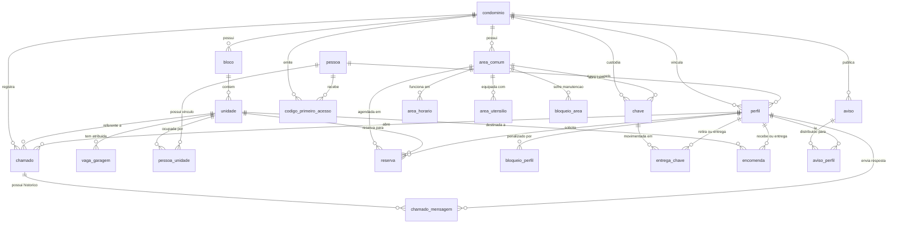

# Manual Técnico e Dicionário de Dados do Banco de Dados OASIS

**Sistema Gerenciador:** PostgreSQL 16 (Alpine Linux)  
**Banco de Dados:** `oasis`  
**Arquitetura:** Multi-Tenancy (Multi-Condomínio) com integridade de regras no SGBD  
**Data da Documentação:** 04/11/2026  
**Versão do Esquema:** 2.1 (Multi-Condomínio + Chamados + Vagas Estruturais)  

---

## 1. Visão Geral e Filosofia Arquitetural

O banco de dados do sistema OASIS foi modelado seguindo princípios rigorosos de integridade referencial, normalização relacional e garantia de regras de negócio a nível de banco de dados (*Database-First Integrity*).

### Princípios Chave:
1. **Multi-Tenancy (Multi-Condomínio):**
   - A plataforma opera em modelo multi-inquilino compartilhado (*Shared Database, Shared Schema*).
   - A entidade `condominio` atua como raiz de tenant. Todas as entidades estruturais e operacionais raiz (`bloco`, `area_comum`, `aviso`, `chave`, `codigo_primeiro_acesso`, `chamado`, `perfil`) possuem chave estrangeira direta para `condominio(id_condominio)`.
   - Restrições de unicidade de nomes utilizam chaves compostas (ex: `UNIQUE (id_condominio, nome)` em blocos e áreas comuns), permitindo que condomínios distintos tenham blocos com o mesmo nome (ex: "Bloco A") sem colisão.
2. **Integridade de Negócio via Gatilhos (PL/pgSQL):**
   - As regras centrais de convivência, concorrência de reservas, controle de encomendas e custódia de chaves são executadas por funções e gatilhos PL/pgSQL nativos (regras **RN01** a **RN17**).
   - Qualquer inserção ou alteração que viole uma regra dispara `RAISE EXCEPTION 'RNxx: ...'`, garantindo que mesmo operações manuais ou integrações externas respeitem a integridade estrita do condomínio.
3. **Domínios Fechados via ENUM:**
   - 20 tipos enumerados definem os estados e categorias válidas de perfis, vínculos, reservas, chamados, encomendas e chaves, prevenindo inconsistências de dados.

---

## 2. Diagrama Entidade-Relacionamento (ER)



---

## 3. Tipos Enumerados (ENUMs)

O banco contém 20 tipos enumerados que padronizam valores de controle em todo o sistema:

| Tipo ENUM | Valores Válidos | Descrição de Uso |
|---|---|---|
| `tipo_perfil_enum` | `'MORADOR'`, `'ADMINISTRADOR'`, `'SINDICO'`, `'PORTEIRO'`, `'SUPERADMIN'` | Papéis de acesso de uma pessoa no condomínio. |
| `tipo_vinculo_enum` | `'PROPRIETARIO'`, `'INQUILINO'`, `'DEPENDENTE'`, `'VISITANTE'`, `'PRESTADOR_SERVICO'` | Natureza jurídica/social do vínculo entre pessoa e unidade residencial. |
| `pavimento_enum` | `'TERREO'`, `'SUBSOLO_1'`, `'SUBSOLO_2'` | Pavimento onde se localiza a vaga de garagem. |
| `tipo_vaga_enum` | `'SIMPLES'`, `'DUPLA'` | Configuração física da vaga de garagem. |
| `tipo_acesso_enum` | `'LIVRE'`, `'BIOMETRIA'`, `'FACIAL'`, `'CHAVE'` | Mecanismo de liberação de entrada na área comum. |
| `tipo_uso_enum` | `'COMUM'`, `'EXCLUSIVO'`, `'RESERVAVEL'` | Regra de ocupação do espaço (livre, exclusivo ou com agendamento). |
| `dia_semana_enum` | `'DOMINGO'`, `'SEGUNDA'`, `'TERCA'`, `'QUARTA'`, `'QUINTA'`, `'SEXTA'`, `'SABADO'` | Dias da semana para grade de horários de funcionamento. |
| `status_reserva_enum` | `'ATIVA'`, `'CANCELADA'`, `'CONCLUIDA'` | Ciclo de vida da reserva de área comum. |
| `status_chave_enum` | `'DISPONIVEL'`, `'EMPRESTADA'`, `'EXTRAVIADA'` | Situação física da chave de área comum na portaria. |
| `motivo_bloqueio_area_enum` | `'MANUTENCAO'`, `'LIMPEZA'`, `'EVENTO'`, `'OBRA'` | Justificativa administrativa para fechamento temporário de espaço. |
| `motivo_bloqueio_perfil_enum` | `'INFRACAO'`, `'INADIMPLENCIA'`, `'SOLICITACAO'`, `'OUTRO'` | Motivo da suspensão disciplinar ou financeira de um morador. |
| `tamanho_encomenda_enum` | `'PEQUENO'`, `'MEDIO'`, `'GRANDE'` | Porte volumétrico do pacote entregue na portaria. |
| `status_encomenda_enum` | `'AGUARDANDO_RETIRADA'`, `'RETIRADA'`, `'DEVOLVIDA'` | Ciclo de custódia e entrega da encomenda. |
| `retirado_por_enum` | `'PROPRIO'`, `'TERCEIRO'`, `'PORTEIRO'` | Agente que efetuou a retirada física da encomenda. |
| `escopo_aviso_enum` | `'MURAL'`, `'INDIVIDUAL'` | Alcance da mensagem (comunicado coletivo ou notificação direta). |
| `grau_parentesco_enum` | `'CONJUGE'`, `'FILHO'`, `'PAI_MAE'`, `'OUTRO'` | Classificação de dependentes em relação ao titular da unidade. |
| `status_aprovacao_enum` | `'PENDENTE'`, `'APROVADO'`, `'REJEITADO'` | Situação de moderação de cadastros de moradores pela administração. |
| `status_codigo_enum` | `'DISPONIVEL'`, `'USADO'`, `'EXPIRADO'`, `'CANCELADO'` | Situação de chave alfanumérica de primeiro acesso / convite. |
| `categoria_chamado_enum` | `'LIMPEZA'`, `'AVARIA_QUEBRADO'`, `'MANUTENCAO'`, `'CONVIVENCIA_BARULHO'`, `'OUTROS'` | Classificação temática do chamado/ocorrência aberto por morador. |
| `status_chamado_enum` | `'EM_ANALISE'`, `'EM_ANDAMENTO'`, `'REALIZADA'`, `'ARQUIVADA'` | Fluxo de atendimento e resolução do chamado pelo síndico. |

---

## 4. Dicionário de Dados Completo (21 Tabelas)

### 4.1. Módulo Multi-Tenancy (Inquilinos)

#### Tabela: `condominio`
Armazena as instâncias dos condomínios atendidos pela plataforma.
- **PK:** `id_condominio`
- **Unique:** `slug`, `cnpj` (quando informado)

| Coluna | Tipo | Nulo? | Padrão | Descrição |
|---|---|---|---|---|
| `id_condominio` | `INTEGER` | NOT NULL | `nextval(...)` | Identificador único do condomínio. |
| `nome` | `VARCHAR(150)` | NOT NULL | - | Nome fantasia ou oficial do condomínio. |
| `razao_social` | `VARCHAR(200)` | NULL | - | Razão social registrada em cartório/CNPJ. |
| `cnpj` | `VARCHAR(18)` | NULL | - | CNPJ (formato 00.000.000/0000-00 ou numérico). |
| `slug` | `VARCHAR(100)` | NOT NULL | - | Identificador alfanumérico para URLs e subdomínios (ex: `oasis-central`). |
| `endereco_completo` | `VARCHAR(255)` | NULL | - | Logradouro, número, bairro e complemento. |
| `cidade` | `VARCHAR(100)` | NOT NULL | `'Ponta Grossa'` | Município do empreendimento. |
| `uf` | `VARCHAR(2)` | NOT NULL | `'PR'` | Sigla da unidade federativa. |
| `cep` | `VARCHAR(10)` | NULL | - | Código de Endereçamento Postal. |
| `telefone_contato` | `VARCHAR(20)` | NULL | - | Telefone geral da portaria/administração. |
| `email_contato` | `VARCHAR(150)` | NULL | - | E-mail oficial da administração. |
| `logo_url` | `VARCHAR(255)` | NULL | - | Caminho ou URL da imagem do logotipo. |
| `ativo` | `BOOLEAN` | NOT NULL | `TRUE` | Status operacional do condomínio na plataforma. |
| `criado_em` | `TIMESTAMP` | NOT NULL | `CURRENT_TIMESTAMP` | Data de inclusão da instância. |
| `atualizado_em` | `TIMESTAMP` | NOT NULL | `CURRENT_TIMESTAMP` | Data da última alteração cadastral. |

---

### 4.2. Módulo Estrutural Físico

#### Tabela: `bloco`
Representa os edifícios, torres ou etapas construtivas do condomínio.
- **PK:** `id_bloco`
- **FK:** `id_condominio -> condominio(id_condominio)`
- **Unique:** `uk_bloco_condominio_nome: UNIQUE (id_condominio, nome)`

| Coluna | Tipo | Nulo? | Padrão | Descrição |
|---|---|---|---|---|
| `id_bloco` | `INTEGER` | NOT NULL | `nextval(...)` | Identificador do bloco. |
| `id_condominio` | `INTEGER` | NOT NULL | `1` | Condomínio proprietário do bloco. |
| `nome` | `VARCHAR(50)` | NOT NULL | - | Identificação do bloco (ex: "Torre A", "Oasis"). |
| `descricao` | `VARCHAR(200)` | NULL | - | Detalhes complementares ou localização no lote. |

#### Tabela: `unidade`
Apartamentos ou salas residenciais pertencentes a um bloco.
- **PK:** `id_unidade`
- **FK:** `id_bloco -> bloco(id_bloco) ON DELETE RESTRICT`
- **Unique:** `UNIQUE (id_bloco, numero_apartamento)`
- **Check:** `andar >= 0`, `numero_vagas >= 0`

| Coluna | Tipo | Nulo? | Padrão | Descrição |
|---|---|---|---|---|
| `id_unidade` | `INTEGER` | NOT NULL | `nextval(...)` | Identificador da unidade residencial. |
| `id_bloco` | `INTEGER` | NOT NULL | - | Bloco ao qual pertence. |
| `numero_apartamento` | `VARCHAR(10)` | NOT NULL | - | Número comercial do apartamento (ex: "101", "T-01"). |
| `andar` | `INTEGER` | NOT NULL | - | Número do pavimento (0 para térreo). |
| `numero_vagas` | `INTEGER` | NOT NULL | `1` | Quantidade de vagas de garagem atribuídas contratualmente. |

#### Tabela: `vaga_garagem`
Vagas de estacionamento vinculadas fisicamente às unidades residenciais.
- **PK:** `id_vaga`
- **FK:** `id_unidade -> unidade(id_unidade) ON DELETE CASCADE`
- **Unique:** `UNIQUE (id_unidade, identificacao)`
- **Check:** `metragem_m2 > 0`

| Coluna | Tipo | Nulo? | Padrão | Descrição |
|---|---|---|---|---|
| `id_vaga` | `INTEGER` | NOT NULL | `nextval(...)` | Identificador único da vaga. |
| `id_unidade` | `INTEGER` | NOT NULL | - | Unidade residencial à qual a vaga pertence. |
| `identificacao` | `VARCHAR(20)` | NOT NULL | - | Código impresso na vaga (ex: "G-101", "V-05A"). |
| `pavimento` | `pavimento_enum` | NOT NULL | `'TERREO'` | Andar do estacionamento (`TERREO`, `SUBSOLO_1`, `SUBSOLO_2`). |
| `tipo_vaga` | `tipo_vaga_enum` | NOT NULL | `'SIMPLES'` | Configuração (`SIMPLES` ou `DUPLA` gaveta). |
| `coberta` | `BOOLEAN` | NOT NULL | `TRUE` | Indica se a vaga possui cobertura física. |
| `metragem_m2` | `NUMERIC(6,2)` | NOT NULL | `12.00` | Área privativa da vaga em metros quadrados. |

---

### 4.3. Módulo de Pessoas, Acesso e Permissões

#### Tabela: `pessoa`
Pessoas físicas cadastradas na base de dados global do condomínio.
- **PK:** `id_pessoa`
- **Unique:** `cpf`, `email`
- **Check:** `email ~* '^[A-Za-z0-9._%+-]+@[A-Za-z0-9.-]+\.[A-Za-z]{2,}$'`

| Coluna | Tipo | Nulo? | Padrão | Descrição |
|---|---|---|---|---|
| `id_pessoa` | `INTEGER` | NOT NULL | `nextval(...)` | Identificador único da pessoa. |
| `firebase_uid` | `VARCHAR(128)` | NULL | - | UID de autenticação Firebase (legado/opcional). |
| `nome` | `VARCHAR(150)` | NOT NULL | - | Nome completo da pessoa. |
| `email` | `VARCHAR(150)` | NOT NULL | - | E-mail para autenticação e notificações. |
| `cpf` | `VARCHAR(14)` | NOT NULL | - | Cadastro de Pessoa Física (11 dígitos limpos ou formatados). |
| `data_nascimento` | `DATE` | NOT NULL | - | Data de nascimento (usada para validar idade mínima em áreas). |
| `celular` | `VARCHAR(20)` | NOT NULL | - | Telefone de contato e WhatsApp. |
| `senha_hash` | `VARCHAR(255)` | NULL | - | Hash bcrypt da credencial de acesso. |
| `ativo` | `BOOLEAN` | NOT NULL | `TRUE` | Status de permissão de acesso geral. |
| `status_conta` | `VARCHAR(20)` | NOT NULL | `'ATIVO'` | Situação da conta (`ATIVO`, `BLOQUEADO`). |
| `papel_controle` | `VARCHAR(30)` | NOT NULL | `'RESIDENCIAL'` | Classificação operacional (`RESIDENCIAL`, `PRESTADOR`, `VISITANTE`). |
| `tipo_servico` | `VARCHAR(100)` | NULL | - | Especialidade se for prestador de serviço. |
| `foto_url` | `VARCHAR(255)` | NULL | - | Caminho da imagem de perfil. |

#### Tabela: `pessoa_unidade`
Registra a ocupação ou posse de uma unidade por uma pessoa física.
- **PK:** `id_pessoa_unidade`
- **FK:** `id_pessoa -> pessoa(id_pessoa) ON DELETE RESTRICT`
- **FK:** `id_unidade -> unidade(id_unidade) ON DELETE RESTRICT`
- **FK:** `id_responsavel -> pessoa(id_pessoa) ON DELETE RESTRICT`
- **Unique:** `UNIQUE (id_pessoa, id_unidade, tipo_vinculo, data_inicio_ocupacao)`
- **Check:** `data_fim_ocupacao IS NULL OR data_fim_ocupacao >= data_inicio_ocupacao`

| Coluna | Tipo | Nulo? | Padrão | Descrição |
|---|---|---|---|---|
| `id_pessoa_unidade` | `INTEGER` | NOT NULL | `nextval(...)` | Identificador do vínculo de ocupação. |
| `id_pessoa` | `INTEGER` | NOT NULL | - | Pessoa vinculada à residência. |
| `id_unidade` | `INTEGER` | NOT NULL | - | Apartamento correspondente. |
| `tipo_vinculo` | `tipo_vinculo_enum` | NOT NULL | - | `PROPRIETARIO`, `INQUILINO`, `DEPENDENTE`, `VISITANTE`... |
| `data_inicio_ocupacao` | `DATE` | NOT NULL | `CURRENT_DATE` | Data de início da vigência do vínculo. |
| `data_fim_ocupacao` | `DATE` | NULL | - | Data de encerramento do vínculo (se preenchido, vínculo histórico). |
| `reside` | `BOOLEAN` | NOT NULL | `TRUE` | Indica se a pessoa reside ativamente no local. |
| `grau_parentesco` | `grau_parentesco_enum` | NULL | - | Grau se for dependente (`CONJUGE`, `FILHO`, etc.). |
| `id_responsavel` | `INTEGER` | NULL | - | Titular responsável pelo dependente na mesma unidade (**RN15**). |
| `status_aprovacao` | `status_aprovacao_enum` | NOT NULL | `'PENDENTE'` | Moderação do cadastro (`PENDENTE`, `APROVADO`, `REJEITADO`). |

#### Tabela: `perfil`
Papeis operacionais atribuídos a uma pessoa dentro de um condomínio específico.
- **PK:** `id_perfil`
- **FK:** `id_pessoa -> pessoa(id_pessoa) ON DELETE RESTRICT`
- **FK:** `id_condominio -> condominio(id_condominio)`
- **Unique:** `UNIQUE (id_pessoa, tipo_perfil, data_inicio)`
- **Check:** `data_fim IS NULL OR data_fim >= data_inicio`

| Coluna | Tipo | Nulo? | Padrão | Descrição |
|---|---|---|---|---|
| `id_perfil` | `INTEGER` | NOT NULL | `nextval(...)` | Identificador do perfil de acesso. |
| `id_pessoa` | `INTEGER` | NOT NULL | - | Pessoa física detentora do perfil. |
| `id_condominio` | `INTEGER` | NULL | - | Condomínio onde o perfil tem validade (NULL para perfis mestres globais). |
| `tipo_perfil` | `tipo_perfil_enum` | NOT NULL | - | `MORADOR`, `ADMINISTRADOR`, `SINDICO`, `PORTEIRO`, `SUPERADMIN`. |
| `data_inicio` | `DATE` | NOT NULL | `CURRENT_DATE` | Data de início de vigência. |
| `data_fim` | `DATE` | NULL | - | Data de revogação/expiração do papel. |
| `recebe_notificacao` | `BOOLEAN` | NOT NULL | `TRUE` | Flag para envio de notificações push/e-mail. |
| `token_fcm` | `VARCHAR(255)` | NULL | - | Token Firebase Cloud Messaging para notificações em dispositivo móvel. |

#### Tabela: `codigo_primeiro_acesso`
Tokens seguros descartáveis de ativação de conta ou redefinição de credenciais.
- **PK:** `id_codigo`
- **FK:** `id_pessoa -> pessoa(id_pessoa)`
- **FK:** `id_condominio -> condominio(id_condominio)`
- **FK:** `id_perfil_gerador -> perfil(id_perfil)`
- **Unique:** `UNIQUE (codigo)`

| Coluna | Tipo | Nulo? | Padrão | Descrição |
|---|---|---|---|---|
| `id_codigo` | `INTEGER` | NOT NULL | `nextval(...)` | Identificador do token. |
| `id_condominio` | `INTEGER` | NOT NULL | `1` | Condomínio emissor do convite de acesso. |
| `id_pessoa` | `INTEGER` | NOT NULL | - | Pessoa autorizada a resgatar o acesso. |
| `id_perfil_gerador` | `INTEGER` | NULL | - | Síndico ou administrador que gerou o convite. |
| `codigo` | `VARCHAR(32)` | NOT NULL | - | Hash alfanumérico seguro (ex: `OASIS-982147`). |
| `status` | `status_codigo_enum` | NOT NULL | `'DISPONIVEL'` | `DISPONIVEL`, `USADO`, `EXPIRADO`, `CANCELADO`. |
| `data_geracao` | `TIMESTAMP` | NOT NULL | `CURRENT_TIMESTAMP` | Data/hora de emissão do convite. |
| `data_expiracao` | `TIMESTAMP` | NOT NULL | - | Prazo de validade do código. |
| `data_uso` | `TIMESTAMP` | NULL | - | Data/hora em que o primeiro acesso foi concluído. |

---

### 4.4. Módulo de Áreas Comuns e Reservas

#### Tabela: `area_comum`
Espaços coletivos do condomínio disponíveis para convivência ou agendamento.
- **PK:** `id_area`
- **FK:** `id_condominio -> condominio(id_condominio)`
- **Unique:** `uk_area_condominio_nome: UNIQUE (id_condominio, nome)`
- **Check:** `capacidade_maxima > 0`, `antecedencia_maxima_dias >= antecedencia_minima_dias`

| Coluna | Tipo | Nulo? | Padrão | Descrição |
|---|---|---|---|---|
| `id_area` | `INTEGER` | NOT NULL | `nextval(...)` | Identificador do espaço físico. |
| `id_condominio` | `INTEGER` | NOT NULL | `1` | Condomínio proprietário do espaço. |
| `nome` | `VARCHAR(100)` | NOT NULL | - | Nome da área (ex: "Salão de Festas", "Churrasqueira"). |
| `descricao` | `VARCHAR(300)` | NULL | - | Descrição, regras de uso e mobília disponível. |
| `capacidade_maxima` | `INTEGER` | NOT NULL | - | Lotação máxima de convidados/ocupantes permitida (**RN04**). |
| `tipo_acesso` | `tipo_acesso_enum` | NOT NULL | - | Controle de entrada (`LIVRE`, `CHAVE`, `BIOMETRIA`). |
| `tipo_uso` | `tipo_uso_enum` | NOT NULL | - | Regime (`COMUM`, `EXCLUSIVO`, `RESERVAVEL`). |
| `permite_reserva_simultanea` | `BOOLEAN` | NOT NULL | `FALSE` | Permite reservas concomitantes de unidades distintas (**RN01**). |
| `unidades_simultaneas_max` | `INTEGER` | NOT NULL | `1` | Máximo de reservas paralelas se permitido. |
| `antecedencia_minima_dias` | `INTEGER` | NOT NULL | `0` | Dias mínimos antes do evento para reservar (**RN06**). |
| `antecedencia_minima_horas` | `INTEGER` | NOT NULL | `0` | Horas mínimas de antecedência para reservas no mesmo dia (**RN06**). |
| `antecedencia_maxima_dias` | `INTEGER` | NOT NULL | `30` | Janela máxima futura de antecedência (**RN06**). |
| `taxa_reserva` | `NUMERIC(10,2)` | NOT NULL | `0.00` | Taxa de manutenção/limpeza em Reais. |
| `tipo_taxa` | `VARCHAR(30)` | NOT NULL | `'ISENTO'` | Modalidade da cobrança (`ISENTO`, `BOLETO_CONDOMINIAL`, `DIRETO`). |
| `horario_inicio_padrao` | `TIME` | NOT NULL | `'08:00:00'` | Horário de abertura padrão. |
| `horario_fim_padrao` | `TIME` | NOT NULL | `'22:00:00'` | Horário de fechamento padrão. |
| `ativo` | `BOOLEAN` | NOT NULL | `TRUE` | Disponibilidade do espaço para o condomínio. |
| `foto_url` | `VARCHAR(255)` | NULL | - | Foto de capa do espaço. |
| `idade_minima` | `INTEGER` | NOT NULL | `0` | Idade mínima do solicitante da reserva (**RN16**). |
| `tempo_limpeza_minutos` | `INTEGER` | NOT NULL | `0` | Intervalo de higienização exigido entre reservas consecutivas. |
| `reserva_dia_inteiro` | `BOOLEAN` | NOT NULL | `FALSE` | Se verdadeiro, a reserva ocupa o dia completo. |
| `limite_reservas_periodo` | `INTEGER` | NULL | - | Quantidade máxima de reservas por unidade (**RN07**). |
| `tipo_periodo_limite` | `VARCHAR(20)` | NULL | - | Periodicidade do limite (`DIARIO`, `SEMANAL`, `MENSAL`). |

#### Tabela: `area_horario`
Grade de funcionamento do espaço por dia da semana (**RN05**).
- **PK:** `id_horario`
- **FK:** `id_area -> area_comum(id_area) ON DELETE CASCADE`
- **Unique:** `UNIQUE (id_area, dia_semana)`
- **Check:** `hora_fim > hora_inicio`

| Coluna | Tipo | Nulo? | Padrão | Descrição |
|---|---|---|---|---|
| `id_horario` | `INTEGER` | NOT NULL | `nextval(...)` | Identificador do horário de operação. |
| `id_area` | `INTEGER` | NOT NULL | - | Área comum associada. |
| `dia_semana` | `dia_semana_enum` | NOT NULL | - | Dia da semana (`DOMINGO` a `SABADO`). |
| `hora_inicio` | `TIME` | NOT NULL | - | Horário de abertura. |
| `hora_fim` | `TIME` | NOT NULL | - | Horário de encerramento das atividades. |

#### Tabela: `area_utensilio`
Inventário de equipamentos, eletrodomésticos e mobílias do espaço.
- **PK:** `id_utensilio`
- **FK:** `id_area -> area_comum(id_area) ON DELETE CASCADE`
- **Check:** `quantidade >= 0`

| Coluna | Tipo | Nulo? | Padrão | Descrição |
|---|---|---|---|---|
| `id_utensilio` | `INTEGER` | NOT NULL | `nextval(...)` | Identificador do item de patrimônio. |
| `id_area` | `INTEGER` | NOT NULL | - | Área onde o item se localiza. |
| `nome` | `VARCHAR(100)` | NOT NULL | - | Nome do utensílio (ex: "Freezer", "Cadeira"). |
| `quantidade` | `INTEGER` | NOT NULL | `1` | Quantidade disponível no espaço. |
| `estado_conservacao` | `VARCHAR(50)` | NOT NULL | `'BOM'` | Estado físico (`NOVO`, `BOM`, `REGULAR`). |

#### Tabela: `bloqueio_area`
Bloqueios administrativos temporários que impedem reservas (**RN02**).
- **PK:** `id_bloqueio`
- **FK:** `id_area -> area_comum(id_area) ON DELETE CASCADE`
- **FK:** `id_perfil_registro -> perfil(id_perfil)`
- **Check:** `data_hora_fim > data_hora_inicio`

| Coluna | Tipo | Nulo? | Padrão | Descrição |
|---|---|---|---|---|
| `id_bloqueio` | `INTEGER` | NOT NULL | `nextval(...)` | Identificador do bloqueio. |
| `id_area` | `INTEGER` | NOT NULL | - | Área interditada. |
| `id_perfil_registro` | `INTEGER` | NOT NULL | - | Administrador ou síndico que efetuou o bloqueio. |
| `motivo` | `motivo_bloqueio_area_enum` | NOT NULL | - | Motivo da indisponibilidade (`MANUTENCAO`, `LIMPEZA`, etc.). |
| `descricao` | `VARCHAR(300)` | NULL | - | Detalhamento sobre o serviço executado. |
| `data_hora_inicio` | `TIMESTAMP` | NOT NULL | - | Início da interdição. |
| `data_hora_fim` | `TIMESTAMP` | NOT NULL | - | Fim da interdição. |

#### Tabela: `bloqueio_perfil`
Penalidades aplicadas a perfis de moradores por infração ou inadimplência (**RN03**, **RN17**).
- **PK:** `id_bloqueio_perfil`
- **FK:** `id_perfil -> perfil(id_perfil)`
- **FK:** `id_perfil_registro -> perfil(id_perfil)`
- **Check:** `data_hora_fim IS NULL OR data_hora_fim > data_hora_inicio`

| Coluna | Tipo | Nulo? | Padrão | Descrição |
|---|---|---|---|---|
| `id_bloqueio_perfil` | `INTEGER` | NOT NULL | `nextval(...)` | Identificador da penalidade. |
| `id_perfil` | `INTEGER` | NOT NULL | - | Morador penalizado com suspensão de reservas. |
| `id_perfil_registro` | `INTEGER` | NOT NULL | - | Síndico ou administrador que aplicou a sanção. |
| `motivo` | `motivo_bloqueio_perfil_enum` | NOT NULL | - | Causa (`INFRACAO`, `INADIMPLENCIA`, etc.). |
| `descricao` | `VARCHAR(300)` | NULL | - | Justificativa ou artigo do regulamento infringido. |
| `data_hora_inicio` | `TIMESTAMP` | NOT NULL | `CURRENT_TIMESTAMP` | Início da vigência do bloqueio. |
| `data_hora_fim` | `TIMESTAMP` | NULL | - | Fim do bloqueio (se NULL, bloqueio por tempo indeterminado). |

#### Tabela: `reserva`
Registros de agendamento de áreas comuns efetuados pelos moradores.
- **PK:** `id_reserva`
- **FK:** `id_area -> area_comum(id_area)`
- **FK:** `id_unidade -> unidade(id_unidade)`
- **FK:** `id_perfil -> perfil(id_perfil)`
- **Check:** `data_hora_fim > data_hora_inicio`, `quantidade_pessoas > 0`

| Coluna | Tipo | Nulo? | Padrão | Descrição |
|---|---|---|---|---|
| `id_reserva` | `INTEGER` | NOT NULL | `nextval(...)` | Identificador único da reserva. |
| `id_area` | `INTEGER` | NOT NULL | - | Espaço reservado. |
| `id_unidade` | `INTEGER` | NOT NULL | - | Residência para a qual a reserva é computada. |
| `id_perfil` | `INTEGER` | NOT NULL | - | Morador autor do agendamento. |
| `data_hora_inicio` | `TIMESTAMP` | NOT NULL | - | Início do período agendado. |
| `data_hora_fim` | `TIMESTAMP` | NOT NULL | - | Término do período agendado. |
| `quantidade_pessoas` | `INTEGER` | NOT NULL | - | Total de pessoas declaradas para o evento (**RN04**). |
| `status` | `status_reserva_enum` | NOT NULL | `'ATIVA'` | Situação (`ATIVA`, `CANCELADA`, `CONCLUIDA`). |
| `motivo_cancelamento`| `VARCHAR(200)` | NULL | - | Justificativa se cancelada (**RN08**). |
| `data_cancelamento` | `TIMESTAMP` | NULL | - | Momento exato em que o cancelamento foi registrado. |
| `data_criacao` | `TIMESTAMP` | NOT NULL | `CURRENT_TIMESTAMP` | Data/hora em que a reserva foi solicitada. |

---

### 4.5. Módulo de Portaria, Chaves e Encomendas

#### Tabela: `chave`
Chaves físicas de áreas comuns custodiadas na portaria.
- **PK:** `id_chave`
- **FK:** `id_condominio -> condominio(id_condominio)`
- **FK:** `id_area -> area_comum(id_area)`
- **Unique:** `UNIQUE (id_area, codigo)`

| Coluna | Tipo | Nulo? | Padrão | Descrição |
|---|---|---|---|---|
| `id_chave` | `INTEGER` | NOT NULL | `nextval(...)` | Identificador da chave física. |
| `id_condominio` | `INTEGER` | NOT NULL | `1` | Condomínio proprietário da chave. |
| `id_area` | `INTEGER` | NOT NULL | - | Espaço ao qual a chave dá acesso. |
| `codigo` | `VARCHAR(20)` | NOT NULL | - | Código identificador gravado na chave (ex: "CH-SAL-01"). |
| `status` | `status_chave_enum` | NOT NULL | `'DISPONIVEL'` | Situação (`DISPONIVEL`, `EMPRESTADA`, `EXTRAVIADA`). |
| `observacao` | `VARCHAR(200)` | NULL | - | Observações adicionais do claviculário. |

#### Tabela: `entrega_chave`
Histórico de retiradas e devoluções de chaves na portaria (**RN09**, **RN10**).
- **PK:** `id_entrega_chave`
- **FK:** `id_chave -> chave(id_chave)`
- **FK:** `id_perfil_solicitante -> perfil(id_perfil)`
- **FK:** `id_perfil_entrega -> perfil(id_perfil)`
- **FK:** `id_perfil_recebimento -> perfil(id_perfil)`
- **Check:** `data_hora_devolucao IS NULL OR data_hora_devolucao >= data_hora_retirada`

| Coluna | Tipo | Nulo? | Padrão | Descrição |
|---|---|---|---|---|
| `id_entrega_chave` | `INTEGER` | NOT NULL | `nextval(...)` | Identificador do empréstimo. |
| `id_chave` | `INTEGER` | NOT NULL | - | Chave retirada. |
| `id_perfil_solicitante` | `INTEGER` | NOT NULL | - | Morador ou prestador que tomou a chave. |
| `id_perfil_entrega` | `INTEGER` | NOT NULL | - | Porteiro que entregou a chave. |
| `data_hora_retirada` | `TIMESTAMP` | NOT NULL | `CURRENT_TIMESTAMP` | Momento da retirada da chave na portaria. |
| `data_hora_devolucao` | `TIMESTAMP` | NULL | - | Momento da devolução física ao claviculário. |
| `id_perfil_recebimento`| `INTEGER` | NULL | - | Porteiro que recebeu a chave na devolução. |
| `observacoes` | `VARCHAR(300)` | NULL | - | Avarias na chave ou relatos de ocorrência. |

#### Tabela: `encomenda`
Pacotes postais e encomendas recebidas pela portaria para as residências (**RN11**, **RN12**).
- **PK:** `id_encomenda`
- **FK:** `id_unidade -> unidade(id_unidade)`
- **FK:** `id_perfil_recebimento -> perfil(id_perfil)`
- **FK:** `id_perfil_entrega -> perfil(id_perfil)`
- **Check:** `data_hora_retirada IS NULL OR data_hora_retirada >= data_hora_recebimento`

| Coluna | Tipo | Nulo? | Padrão | Descrição |
|---|---|---|---|---|
| `id_encomenda` | `INTEGER` | NOT NULL | `nextval(...)` | Identificador do pacote registrado. |
| `id_unidade` | `INTEGER` | NOT NULL | - | Unidade residencial destinatária do pacote. |
| `id_perfil_recebimento`| `INTEGER` | NOT NULL | - | Porteiro que recebeu o pacote dos correios/entregador. |
| `destinatario_nome` | `VARCHAR(150)` | NOT NULL | - | Nome impresso na etiqueta da encomenda. |
| `codigo_rastreio` | `VARCHAR(100)` | NULL | - | Código de rastreamento (Correios, transportadora). |
| `tamanho` | `tamanho_encomenda_enum` | NOT NULL | `'MEDIO'` | Porte (`PEQUENO`, `MEDIO`, `GRANDE`). |
| `status` | `status_encomenda_enum` | NOT NULL | `'AGUARDANDO_RETIRADA'` | Situação (`AGUARDANDO_RETIRADA`, `RETIRADA`, `DEVOLVIDA`). |
| `data_hora_recebimento`| `TIMESTAMP` | NOT NULL | `CURRENT_TIMESTAMP` | Momento em que a encomenda deu entrada na portaria. |
| `data_hora_retirada` | `TIMESTAMP` | NULL | - | Momento em que o morador retirou o pacote. |
| `id_perfil_entrega` | `INTEGER` | NULL | - | Porteiro que liberou o pacote na portaria. |
| `retirado_por` | `retirado_por_enum` | NULL | - | Quem retirou (`PROPRIO`, `TERCEIRO`, `PORTEIRO`). |
| `nome_terceiro` | `VARCHAR(150)` | NULL | - | Nome da pessoa que retirou se for terceiro. |
| `documento_terceiro` | `VARCHAR(30)` | NULL | - | Documento da pessoa que retirou se for terceiro. |
| `observacoes` | `VARCHAR(300)` | NULL | - | Detalhes sobre avarias na embalagem ou perecíveis. |

---

### 4.6. Módulo de Comunicação (Mural de Avisos)

#### Tabela: `aviso`
Comunicados oficiais publicados pela administração ou síndico (**RN13**).
- **PK:** `id_aviso`
- **FK:** `id_condominio -> condominio(id_condominio)`
- **FK:** `id_perfil_autor -> perfil(id_perfil)`
- **Check:** `data_expiracao IS NULL OR data_expiracao >= data_publicacao`

| Coluna | Tipo | Nulo? | Padrão | Descrição |
|---|---|---|---|---|
| `id_aviso` | `INTEGER` | NOT NULL | `nextval(...)` | Identificador do comunicado. |
| `id_condominio` | `INTEGER` | NOT NULL | `1` | Condomínio onde o aviso tem validade. |
| `id_perfil_autor` | `INTEGER` | NOT NULL | - | Síndico ou administrador autor da publicação. |
| `titulo` | `VARCHAR(150)` | NOT NULL | - | Assunto do comunicado. |
| `conteudo` | `TEXT` | NOT NULL | - | Mensagem completa em texto ou markdown. |
| `escopo` | `escopo_aviso_enum` | NOT NULL | `'MURAL'` | Alcance da mensagem (`MURAL` ou `INDIVIDUAL`). |
| `data_publicacao` | `TIMESTAMP` | NOT NULL | `CURRENT_TIMESTAMP` | Data e hora em que a publicação foi ao ar. |
| `data_expiracao` | `DATE` | NULL | - | Data limite após a qual o aviso não é mais exibido. |
| `urgente` | `BOOLEAN` | NOT NULL | `FALSE` | Destaque visual e prioridade nas notificações. |

#### Tabela: `aviso_perfil`
Distribuição individual e controle de leitura de cada aviso por perfil (**RN14**).
- **PK:** `id_aviso_perfil`
- **FK:** `id_aviso -> aviso(id_aviso) ON DELETE CASCADE`
- **FK:** `id_perfil -> perfil(id_perfil)`
- **Unique:** `UNIQUE (id_aviso, id_perfil)`

| Coluna | Tipo | Nulo? | Padrão | Descrição |
|---|---|---|---|---|
| `id_aviso_perfil` | `INTEGER` | NOT NULL | `nextval(...)` | Identificador da notificação individual. |
| `id_aviso` | `INTEGER` | NOT NULL | - | Aviso associado. |
| `id_perfil` | `INTEGER` | NOT NULL | - | Perfil de morador que recebeu o aviso. |
| `lido` | `BOOLEAN` | NOT NULL | `FALSE` | Indica se o morador abriu e leu o aviso. |
| `data_hora_leitura` | `TIMESTAMP` | NULL | - | Momento exato em que a mensagem foi marcada como lida. |

---

### 4.7. Módulo de Chamados e Ocorrências

#### Tabela: `chamado`
Tickets de atendimento, manutenção ou reclamação abertos por moradores para cada unidade.
- **PK:** `id_chamado`
- **FK:** `id_condominio -> condominio(id_condominio)`
- **FK:** `id_unidade -> unidade(id_unidade)`
- **FK:** `id_perfil_autor -> perfil(id_perfil)`

| Coluna | Tipo | Nulo? | Padrão | Descrição |
|---|---|---|---|---|
| `id_chamado` | `INTEGER` | NOT NULL | `nextval(...)` | Identificador único do chamado. |
| `id_condominio` | `INTEGER` | NOT NULL | `1` | Condomínio onde o chamado foi registrado. |
| `id_unidade` | `INTEGER` | NOT NULL | - | Apartamento solicitante (garante privacidade por unidade). |
| `id_perfil_autor` | `INTEGER` | NOT NULL | - | Morador que formalizou a abertura da solicitação. |
| `categoria` | `categoria_chamado_enum` | NOT NULL | - | Classificação temática (`LIMPEZA`, `AVARIA_QUEBRADO`, etc.). |
| `titulo` | `VARCHAR(150)` | NOT NULL | - | Resumo do problema ou solicitação. |
| `descricao` | `TEXT` | NOT NULL | - | Descrição pormenorizada do fato ocorrido. |
| `status` | `status_chamado_enum` | NOT NULL | `'EM_ANALISE'` | Situação (`EM_ANALISE`, `EM_ANDAMENTO`, `REALIZADA`, `ARQUIVADA`). |
| `foto_url` | `VARCHAR(255)` | NULL | - | Foto comprobatória ou evidência anexada pelo morador. |
| `criado_em` | `TIMESTAMP` | NOT NULL | `CURRENT_TIMESTAMP` | Data/hora de abertura do chamado. |
| `atualizado_em` | `TIMESTAMP` | NOT NULL | `CURRENT_TIMESTAMP` | Data/hora da última movimentação ou resposta. |

#### Tabela: `chamado_mensagem`
Canal de mensagens e respostas bidirecionais entre morador e síndico no chamado.
- **PK:** `id_mensagem`
- **FK:** `id_chamado -> chamado(id_chamado) ON DELETE CASCADE`
- **FK:** `id_perfil -> perfil(id_perfil)`

| Coluna | Tipo | Nulo? | Padrão | Descrição |
|---|---|---|---|---|
| `id_mensagem` | `INTEGER` | NOT NULL | `nextval(...)` | Identificador da mensagem. |
| `id_chamado` | `INTEGER` | NOT NULL | - | Chamado ao qual a resposta pertence. |
| `id_perfil` | `INTEGER` | NOT NULL | - | Autor da mensagem (morador ou síndico/administrador). |
| `mensagem` | `TEXT` | NOT NULL | - | Conteúdo da resposta ou posicionamento. |
| `criado_em` | `TIMESTAMP` | NOT NULL | `CURRENT_TIMESTAMP` | Data e hora do envio da mensagem. |

---

## 5. Regras de Negócio e Gatilhos PL/pgSQL (RN01 a RN17)

As regras são impostas via gatilhos PL/pgSQL em `banco/04_gatilhos.sql`:

| Regra | Tabela Alvo | Evento Disparador | Função PL/pgSQL | Descrição de Validação |
|---|---|---|---|---|
| **RN01** | `reserva` | BEFORE INSERT OR UPDATE | `fn_valida_reserva()` | **Conflito de Horário:** Impede que a mesma unidade tenha reservas sobrepostas na mesma área e limita reservas simultâneas de unidades diferentes caso `permite_reserva_simultanea = false` ou ultrapasse `unidades_simultaneas_max`. |
| **RN02** | `reserva` | BEFORE INSERT OR UPDATE | `fn_valida_reserva()` | **Área Bloqueada:** Impede agendamento em datas que coincidam com manutenções ativas na tabela `bloqueio_area`. |
| **RN03** | `reserva` | BEFORE INSERT OR UPDATE | `fn_valida_reserva()` | **Morador Penalizado:** Impede reserva se o perfil do solicitante possuir sanção vigente na tabela `bloqueio_perfil`. |
| **RN04** | `reserva` | BEFORE INSERT OR UPDATE | `fn_valida_reserva()` | **Capacidade de Lotação:** Impede que `quantidade_pessoas` exceda a `capacidade_maxima` configurada na área. |
| **RN05** | `reserva` | BEFORE INSERT OR UPDATE | `fn_valida_reserva()` | **Janela de Funcionamento:** Valida se o dia e os horários da reserva estão estritamente contidos na grade de horários (`area_horario`) do dia da semana. |
| **RN06** | `reserva` | BEFORE INSERT OR UPDATE | `fn_valida_reserva()` | **Antecedência de Agendamento:** Impede reservas no passado e exige cumprimento da antecedência mínima (em horas ou dias) e máxima permitida na área. |
| **RN07** | `reserva` | BEFORE INSERT OR UPDATE | `fn_valida_reserva()` | **Limite de Reservas por Período:** Restringe o total de reservas ativas por unidade (diário, semanal ou mensal) conforme política da área. |
| **RN08** | `reserva` | BEFORE UPDATE | `fn_cancela_reserva()` | **Controle de Cancelamento:** Registra `data_cancelamento` e exige preenchimento obrigatório de `motivo_cancelamento`. |
| **RN09** | `entrega_chave` | BEFORE e AFTER INSERT | `fn_valida_emprestimo_chave()` / `fn_aplica_emprestimo_chave()` | **Empréstimo de Chave:** Valida disponibilidade da chave e atualiza seu status para `'EMPRESTADA'`. |
| **RN10** | `entrega_chave` | BEFORE e AFTER UPDATE | `fn_valida_devolucao_chave()` / `fn_aplica_devolucao_chave()` | **Devolução de Chave:** Exige `id_perfil_recebimento` e altera o status da chave de volta para `'DISPONIVEL'`. |
| **RN11** | `encomenda` | AFTER INSERT | `fn_notifica_encomenda()` | **Notificação de Pacote:** Cria automaticamente notificação/aviso individual aos moradores da unidade destinatária sobre a chegada do pacote. |
| **RN12** | `encomenda` | BEFORE UPDATE | `fn_retirada_encomenda()` | **Retirada de Pacote:** Valida preenchimento obrigatório de `retirado_por`, `data_hora_retirada` e dados de terceiro quando aplicável. |
| **RN13** | `aviso` | AFTER INSERT | `fn_distribui_aviso()` | **Distribuição de Avisos:** Ao publicar comunicado de escopo `MURAL`, gera automaticamente os registros em `aviso_perfil` para todos os moradores ativos do condomínio. |
| **RN14** | `aviso_perfil` | BEFORE UPDATE | `fn_leitura_aviso()` | **Controle de Leitura:** Preenche automaticamente `data_hora_leitura = CURRENT_TIMESTAMP` no momento em que `lido` transiciona para `TRUE`. |
| **RN15** | `pessoa_unidade`| BEFORE INSERT OR UPDATE | `fn_valida_dependente()` | **Vínculo de Dependente:** Exige que todo dependente possua `id_responsavel` apontando para um titular (`PROPRIETARIO` ou `INQUILINO`) ativo na mesma residência. |
| **RN16** | `reserva` | BEFORE INSERT OR UPDATE | `fn_valida_reserva()` | **Idade Mínima:** Bloqueia a reserva caso a data de nascimento do titular indique idade inferior à exigida pela área comum. |
| **RN17** | `bloqueio_perfil`| AFTER INSERT | `fn_bloqueio_perfil_cancela_reservas()` | **Cancelamento por Penalidade:** Cancela imediatamente todas as reservas ativas futuras do morador penalizado. |

---

## 6. Procedimentos de Execução e Migração

### 6.1. Inicialização Automática no Docker
No arquivo `docker-compose.yml`, o container `oasis-banco` mapeia o volume com inicialização automática:
- O arquivo `banco/oasis_banco_completo.sql` é executado na primeira inicialização do banco (`/docker-entrypoint-initdb.d/01_oasis_banco_completo.sql`).
- Contém a totalidade das definições (tipos, tabelas, índices, cargas iniciais e gatilhos).

### 6.2. Execução Manual Passo a Passo
Caso deseje provisionar o banco manualmente via CLI (`psql`), execute os arquivos na ordem estrita:

```bash
# 1. Cria tipos enumerados
psql -U postgres -d oasis -f banco/01_banco_e_tipos.sql

# 2. Cria estrutura de tabelas e chaves
psql -U postgres -d oasis -f banco/02_tabelas.sql

# 3. Cria índices e efetua carga inicial do condomínio matriz OASIS
psql -U postgres -d oasis -f banco/03_indices_e_carga.sql

# 4. Cria funções PL/pgSQL e gatilhos de integridade de regras
psql -U postgres -d oasis -f banco/04_gatilhos.sql
```

### 6.3. Sincronização e Migrações em Runtime
Para assegurar compatibilidade contínua em deploys e atualizações, o backend NestJS (`DbService.onModuleInit()`) executa verificações de idempotência no boot:
- Cria a tabela `condominio` caso não exista.
- Cria os tipos enumerados de chamados (`categoria_chamado_enum`, `status_chamado_enum`).
- Cria as tabelas `chamado`, `chamado_mensagem`, `vaga_garagem` caso ainda não existam.
- Aplica a coluna `id_condominio` nas tabelas raiz com valor padrão `1`.
- Garante a presença do usuário mestre `superadmin@oasis.com` com perfil `SUPERADMIN`.
