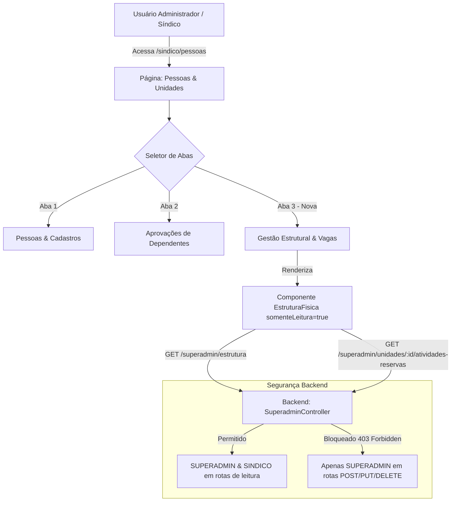
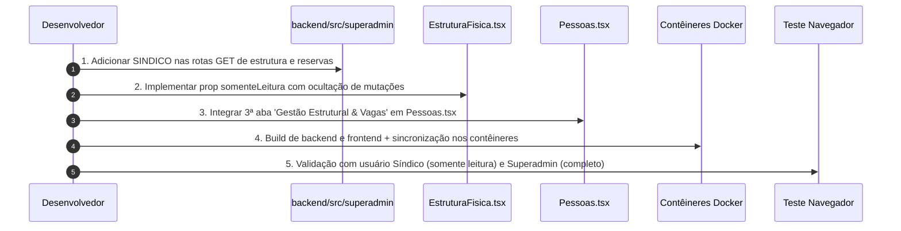

# Plano de Implementação: Gestão Estrutural & Vagas para o Perfil Administrador (Modo Somente Leitura)

**Data:** 16/10/2026  
**Contexto:** OASIS - Sistema de Gestão Condominial  
**Status:** Executado e Concluído com Sucesso  
**Objetivo:** Permitir que o usuário com perfil **Administrador (Síndico)** visualize toda a estrutura física do condomínio (blocos, andares, apartamentos, vagas com metragens e moradores vinculados) diretamente na sessão **"Pessoas & Unidades"**, operando estritamente em **modo somente leitura (consulta)**, sem botões de criação, alteração ou exclusão estrutural.

---

## 1. Visão Geral e Justificativa

Atualmente, o módulo **"Gestão Estrutural & Vagas"** é exclusivo do menu do perfil `SUPERADMIN` (`/superadmin/estrutura`), onde são permitidas operações destrutivas e construtivas de lote (criação/exclusão de blocos, andares, numeração de apartamentos e vagas de garagem).

O **Administrador local (Síndico)** necessita consultar a disposição dos blocos, ver os apartamentos organizados por andar, conferir as vagas de garagem e seus proprietários/moradores, além de abrir os detalhes e histórico de reservas do apartamento. No entanto, para preservar a integridade da planta física do condomínio, o Administrador **não deve ter permissão para alterar a estrutura** (como criar novos blocos, excluir andares ou editar apartamentos).

A solução consiste em integrar a visualização da **Gestão Estrutural & Vagas** como uma **nova aba na sessão "Pessoas & Unidades"** (`/sindico/pessoas`), renderizando o componente de estrutura em **modo somente leitura**.

---

## 2. Matriz de Permissões e Ações

| Elemento / Ação na Tela | Superadmin (`/superadmin/estrutura`) | Administrador / Síndico (`/sindico/pessoas` -> Aba Estrutura) |
| :--- | :---: | :---: |
| **Visualizar Blocos, Andares e Apartamentos** | Sim | **Sim** |
| **Visualizar Vagas e Metragens (m²)** | Sim | **Sim** |
| **Abrir Modal de Moradores do Apartamento** | Sim | **Sim** |
| **Ver Perfil Completo do Morador / Dependentes** | Sim | **Sim** |
| **Ver Atividades & Histórico de Reservas da Unidade** | Sim | **Sim** |
| **Botão WhatsApp de Contato** | Sim | **Sim** |
| **Botão "Gerador Estrutural em Lote"** | Sim | **Ocultado** |
| **Botões "+ Novo Bloco" e "Editar/Excluir Bloco"** | Sim | **Ocultado** |
| **Botões "+ Novo Apartamento" e "Editar/Excluir Apto"** | Sim | **Ocultado** |
| **Botões "+ Novo Andar" e "Mudar Andar"** | Sim | **Ocultado** |
| **Botão "+ Adicionar Vaga" e Excluir Vaga** | Sim | **Ocultado** |

---

## 3. Alterações Arquiteturais



---

## 4. Detalhamento Técnico das Modificações

### 4.1. Backend (`backend/src/superadmin/superadmin.controller.ts`)

Atualmente, a classe `SuperadminController` possui a anotação de classe `@Perfis('SUPERADMIN')`. Para permitir que o Administrador consulte os dados estruturais e de reservas sem ter acesso a métodos de mutação:

1. **Ajuste de Escopo de Perfil na Classe / Métodos**:
   - Alterar a anotação da classe para permitir perfis administrativos gerais ou aplicar o controle granular em cada endpoint.
   - Os endpoints de **leitura** passam a permitir ambos os perfis:
     - `@Get('estrutura')` -> `@Perfis('SUPERADMIN', 'SINDICO')`
     - `@Get('unidades/:id/moradores')` -> `@Perfis('SUPERADMIN', 'SINDICO')`
     - `@Get('unidades/:id/atividades-reservas')` -> `@Perfis('SUPERADMIN', 'SINDICO')`
   - Todos os endpoints de **escrita/mutação** permanecem estritamente restritos:
     - `@Post('blocos/lote')` -> `@Perfis('SUPERADMIN')`
     - `@Post('blocos')`, `@Put('blocos/:id')`, `@Delete('blocos/:id')` -> `@Perfis('SUPERADMIN')`
     - `@Post('blocos/:id/organizar-andares')` -> `@Perfis('SUPERADMIN')`
     - `@Post('blocos/:id/andares/:andar/renomear')` -> `@Perfis('SUPERADMIN')`
     - `@Post('unidades')`, `@Put('unidades/:id')`, `@Delete('unidades/:id')` -> `@Perfis('SUPERADMIN')`
     - `@Post('vagas')`, `@Put('vagas/:id')`, `@Delete('vagas/:id')` -> `@Perfis('SUPERADMIN')`

> **Garantia de Segurança:** Mesmo que alguém tente disparar requisições HTTP manuais de criação ou exclusão estrutural com o token do Síndico, o backend rejeitará imediatamente com `403 Forbidden`.

---

### 4.2. Componente de Estrutura Física (`frontend/src/pages/superadmin/EstruturaFisica.tsx`)

Tornar o componente reutilizável adicionando a interface de propriedades:

```tsx
export interface EstruturaFisicaProps {
  somenteLeitura?: boolean;
}

export default function EstruturaFisica({ somenteLeitura = false }: EstruturaFisicaProps = {}) {
  // ...
}
```

#### Aplicações da flag `somenteLeitura`:
1. **Cabeçalho da Página**:
   - Quando `somenteLeitura === true`:
     - Ocultar badge de "Superadmin" (ou substituir por "Visualização Estrutural").
     - Ocultar botões `Gerador Estrutural em Lote`, `+ Novo Bloco` e `+ Novo Apartamento`.
2. **Barra de Ações do Bloco Selecionado**:
   - Ocultar botões `+ Novo Apartamento`, `+ Novo Andar`, `Organizar Andares`, `Editar Bloco` e `Excluir Bloco`.
3. **Cabeçalho de Cada Andar**:
   - Ocultar `+ Apto no Xº Andar` e `Mudar Andar`.
4. **Cards de Apartamento**:
   - Ocultar botões de edição e exclusão de apartamento (`edit`, `trash`).
   - Ocultar botão `+ Adicionar Vaga`.
   - Nas vagas listadas, ocultar botões de edição/exclusão de vaga.
5. **Modal de Detalhes do Apartamento (`unidadeDetalhesMoradores`)**:
   - Manter 100% das abas "Moradores & Perfis" e "Atividades & Reservas do Apto".
   - Manter os botões de ação do morador ("Ver Perfil", "Atividades" e "WhatsApp").
   - Ajustar o botão de redirecionamento para `/sindico/pessoas` em vez de `/superadmin/pessoas`.

---

### 4.3. Tela Pessoas & Unidades (`frontend/src/pages/sindico/Pessoas.tsx`)

1. **Estado da Aba Ativa**:
   ```tsx
   const [abaAtiva, setAbaAtiva] = useState<'pessoas' | 'aprovacoes' | 'estrutura'>('pessoas');
   ```

2. **Suporte a Query Parameter na URL**:
   - Ler `useSearchParams`: se a URL contiver `?aba=estrutura`, definir `abaAtiva` como `'estrutura'`.

3. **Inclusão da Nova Aba no Seletor**:
   ```tsx
   <button
     onClick={() => setAbaAtiva('estrutura')}
     className={`pb-2.5 px-3.5 text-xs font-bold border-b-2 flex items-center gap-1.5 transition-all cursor-pointer ${
       abaAtiva === 'estrutura'
         ? 'border-purple-600 text-purple-600 dark:border-purple-400 dark:text-purple-400'
         : 'border-transparent text-slate-400 hover:text-slate-600 dark:hover:text-slate-200'
     }`}
   >
     <Icone nome="building" className="h-3.5 w-3.5" />
     Gestão Estrutural & Vagas
   </button>
   ```

4. **Renderização Condicional do Conteúdo**:
   ```tsx
   {abaAtiva === 'estrutura' ? (
     <div className="pt-2">
       <EstruturaFisica somenteLeitura={true} />
     </div>
   ) : abaAtiva === 'aprovacoes' ? (
     // ... renderiza aprovações
   ) : (
     // ... renderiza lista de pessoas e filtros
   )}
   ```

5. **Ajuste dos Botões Superiores no Cabeçalho**:
   - Quando `abaAtiva === 'estrutura'`, omitir os botões de "Novo Cadastro de Morador" e "Cadastrar Visitante/Prestador", mantendo a tela limpa e focada na consulta da estrutura.

---

### 4.4. Rotas e Redirecionamentos (`frontend/src/App.tsx`)

Adicionar uma rota amigável para acesso direto pelo Administrador:
```tsx
<Route
  path="/sindico/estrutura"
  element={
    <Protegida perfil={['ADMINISTRADOR', 'SINDICO']}>
      <EstruturaFisica somenteLeitura={true} />
    </Protegida>
  }
/>
```
Isso permite tanto o acesso embutido na aba de "Pessoas & Unidades" quanto acesso direto por link se necessário.

---

## 5. Roteiro de Execução Passo a Passo



1. **Passo 1: Backend - Ajuste de Permissões**
   - No arquivo `backend/src/superadmin/superadmin.controller.ts`, permitir `@Perfis('SUPERADMIN', 'SINDICO')` nas rotas `GET 'estrutura'` e `GET 'unidades/:id/atividades-reservas'`.
   - Assegurar que todas as rotas `POST`, `PUT`, `DELETE` permaneçam restritas a `SUPERADMIN`.

2. **Passo 2: Frontend - Refatoração de `EstruturaFisica.tsx`**
   - Exportar `EstruturaFisicaProps` com `somenteLeitura?: boolean`.
   - Adicionar verificações `{!somenteLeitura && ( ... )}` nos botões de mutação (criação de blocos, andares, apartamentos, vagas e gerador em lote).

3. **Passo 3: Frontend - Integração em `Pessoas.tsx`**
   - Importar `EstruturaFisica` em `Pessoas.tsx`.
   - Adicionar o estado e botão da aba `'estrutura'`.
   - Renderizar `<EstruturaFisica somenteLeitura={true} />` quando a aba estiver ativa.

4. **Passo 4: Compilação e Deploy Local**
   - Executar `npm.cmd run build` no backend e no frontend.
   - Sincronizar os artefatos compilados nos contêineres `oasis-backend` e `oasis-frontend`.

5. **Passo 5: Validação Funcional com Navegador**
   - Acessar com perfil de **Síndico/Administrador**:
     - Navegar para `Pessoas & Unidades`.
     - Clicar na aba `Gestão Estrutural & Vagas`.
     - Validar que a planta física e as vagas são carregadas perfeitamente.
     - Validar que nenhum botão de edição/criação/exclusão está visível.
     - Clicar em um apartamento com moradores (ex: Apto 231) e testar a abertura do modal de moradores, botão "Ver Perfil", botão "Atividades" e aba de "Atividades & Reservas do Apto".
   - Acessar com perfil de **Superadmin**:
     - Acessar `/superadmin/estrutura` e confirmar que todas as permissões e botões administrativos continuam ativos e intactos.

---

## 6. Critérios de Aceite

- [ ] Administrador visualiza a aba "Gestão Estrutural & Vagas" dentro de "Pessoas & Unidades".
- [ ] Nenhum botão de criação de bloco, lote, apartamento, andar ou vaga é exibido para o administrador.
- [ ] Nenhum botão de edição ou exclusão de bloco, apartamento, andar ou vaga é exibido para o administrador.
- [ ] O administrador consegue clicar em qualquer apartamento para inspecionar moradores, dependentes, ver perfis e reservas do apartamento.
- [ ] O Superadmin continua com acesso irrestrito de criação, edição e exclusão em `/superadmin/estrutura`.
- [ ] Tentativas de chamada direta às APIs de mutação estrutural por usuários administradores locais retornam erro `403 Forbidden`.
