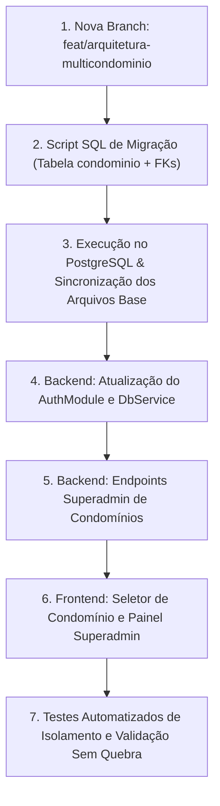

# Plano de Implementação: Arquitetura Multi-Condomínio (Multi-Tenancy) no OASIS

**Data:** 04/11/2026  
**Documento de Origem:** `Documentos/planos_pendentes/estudo_arquitetura_multicondominio.md`  
**Objetivo:** Evoluir o banco de dados e o sistema OASIS do modelo monocondomínio para uma plataforma **Multi-Tenancy Lógica com Isolamento por Linha (Row-Level Tenancy)**, garantindo que múltiplos condomínios operem no mesmo banco com isolamento seguro, zero quebra dos dados existentes do OASIS e custo R$ 0,00 na VPS Oracle.

---

## 1. Diagnóstico do Banco Atual vs. Requisitos Multi-Tenant

Atualmente, o banco de dados do OASIS opera com escopo global único. Para viabilizar múltiplos condomínios com estabilidade e facilidade de manutenção, analisamos tabela por tabela:

### A. Tabelas que receberão `id_condominio` diretamente:
| Tabela | Motivo da Inclusão Direta | Constraint / Índice que Muda |
| :--- | :--- | :--- |
| `bloco` | Blocos pertencem a um condomínio específico | `uk_bloco_nome` vira `UNIQUE (id_condominio, nome)` |
| `area_comum` | Salões, churrasqueiras, piscinas são de cada condomínio | `uk_area_nome` vira `UNIQUE (id_condominio, nome)` |
| `aviso` | Murais e comunicados pertencem ao condomínio | Novo índice `idx_aviso_condominio` |
| `chave` | Chaves físicas pertencem à portaria daquele condomínio | Novo índice `idx_chave_condominio` |
| `codigo_primeiro_acesso` | Códigos de convite gerados para moradores de cada condomínio | Novo índice `idx_cpa_condominio` |
| `chamado` | Ocorrências abertas para a administração daquele condomínio | Novo índice `idx_chamado_condominio` |

### B. Tabelas que herdam o condomínio por relacionamento natural (sem redundância):
- `unidade` $\rightarrow$ Relacionada com `bloco` (que já tem `id_condominio`).
- `vaga_garagem` $\rightarrow$ Relacionada com `unidade`.
- `reserva` $\rightarrow$ Relacionada com `area_comum`.
- `bloqueio_area` $\rightarrow$ Relacionada com `area_comum`.
- `encomenda` $\rightarrow$ Relacionada com `unidade`.
- `chamado_mensagem` $\rightarrow$ Relacionada com `chamado`.

### C. A Entidade `pessoa` e Usuários Globais:
- Uma pessoa pode ser moradora do Condomínio A e proprietária de um apartamento no Condomínio B.
- A tabela `pessoa` permanece global (identificação única por CPF/Email).
- O vínculo com os condomínios ocorre naturalmente através de `pessoa_unidade` (para moradores e proprietários) e através de `perfil` associado a um `id_condominio` (para Síndicos e Porteiros).

---

## 2. Modelagem DDL do Banco de Dados (PostgreSQL)

### Etapa 2.1: Criação da Tabela `condominio` (Tenants)
```sql
CREATE TABLE IF NOT EXISTS condominio (
    id_condominio       SERIAL          PRIMARY KEY,
    nome                VARCHAR(120)    NOT NULL,
    razao_social        VARCHAR(150),
    cnpj                CHAR(14)        UNIQUE,
    slug                VARCHAR(60)     NOT NULL UNIQUE, -- Identificador amigável para URLs/Headers
    endereco_completo   VARCHAR(255),
    cidade              VARCHAR(80)     NOT NULL DEFAULT 'Ponta Grossa',
    uf                  CHAR(2)         NOT NULL DEFAULT 'PR',
    cep                 CHAR(8),
    telefone_contato    VARCHAR(20),
    email_contato       VARCHAR(150),
    logo_url            VARCHAR(255),
    ativo               BOOLEAN         NOT NULL DEFAULT TRUE,
    criado_em           TIMESTAMP WITH TIME ZONE NOT NULL DEFAULT CURRENT_TIMESTAMP,
    atualizado_em       TIMESTAMP WITH TIME ZONE NOT NULL DEFAULT CURRENT_TIMESTAMP
);

CREATE INDEX IF NOT EXISTS idx_condominio_slug ON condominio(slug);
CREATE INDEX IF NOT EXISTS idx_condominio_ativo ON condominio(ativo);
```

### Etapa 2.2: Carga Idempotente do Condomínio Atual (OASIS)
Para garantir **zero quebra** e **zero perda de dados** no ambiente existente:
```sql
INSERT INTO condominio (id_condominio, nome, slug, cidade, uf, ativo)
VALUES (1, 'Condomínio Residencial OASIS', 'oasis-central', 'Ponta Grossa', 'PR', TRUE)
ON CONFLICT (id_condominio) DO UPDATE
SET nome = EXCLUDED.nome, slug = EXCLUDED.slug;

-- Sincronizar sequence para evitar conflito de IDs futuros
SELECT setval('condominio_id_condominio_seq', (SELECT MAX(id_condominio) FROM condominio));
```

### Etapa 2.3: Vinculação Suave das Tabelas com `DEFAULT 1`
Adicionar a coluna `id_condominio` com valor padrão `1` para que todos os registros atuais sejam migrados automaticamente:
```sql
-- 1. Bloco
ALTER TABLE bloco ADD COLUMN IF NOT EXISTS id_condominio INTEGER NOT NULL DEFAULT 1 REFERENCES condominio(id_condominio);
ALTER TABLE bloco DROP CONSTRAINT IF EXISTS bloco_nome_key;
ALTER TABLE bloco DROP CONSTRAINT IF EXISTS uk_bloco_condominio_nome;
ALTER TABLE bloco ADD CONSTRAINT uk_bloco_condominio_nome UNIQUE (id_condominio, nome);
CREATE INDEX IF NOT EXISTS idx_bloco_condominio ON bloco(id_condominio);

-- 2. Área Comum
ALTER TABLE area_comum ADD COLUMN IF NOT EXISTS id_condominio INTEGER NOT NULL DEFAULT 1 REFERENCES condominio(id_condominio);
ALTER TABLE area_comum DROP CONSTRAINT IF EXISTS area_comum_nome_key;
ALTER TABLE area_comum DROP CONSTRAINT IF EXISTS uk_area_condominio_nome;
ALTER TABLE area_comum ADD CONSTRAINT uk_area_condominio_nome UNIQUE (id_condominio, nome);
CREATE INDEX IF NOT EXISTS idx_area_condominio ON area_comum(id_condominio);

-- 3. Aviso
ALTER TABLE aviso ADD COLUMN IF NOT EXISTS id_condominio INTEGER NOT NULL DEFAULT 1 REFERENCES condominio(id_condominio);
CREATE INDEX IF NOT EXISTS idx_aviso_condominio ON aviso(id_condominio);

-- 4. Chave
ALTER TABLE chave ADD COLUMN IF NOT EXISTS id_condominio INTEGER NOT NULL DEFAULT 1 REFERENCES condominio(id_condominio);
CREATE INDEX IF NOT EXISTS idx_chave_condominio ON chave(id_condominio);

-- 5. Código de Primeiro Acesso
ALTER TABLE codigo_primeiro_acesso ADD COLUMN IF NOT EXISTS id_condominio INTEGER NOT NULL DEFAULT 1 REFERENCES condominio(id_condominio);
CREATE INDEX IF NOT EXISTS idx_cpa_condominio ON codigo_primeiro_acesso(id_condominio);

-- 6. Chamado
ALTER TABLE chamado ADD COLUMN IF NOT EXISTS id_condominio INTEGER NOT NULL DEFAULT 1 REFERENCES condominio(id_condominio);
CREATE INDEX IF NOT EXISTS idx_chamado_condominio ON chamado(id_condominio);

-- 7. Perfil (Para vincular síndicos e porteiros ao condomínio correspondente)
ALTER TABLE perfil ADD COLUMN IF NOT EXISTS id_condominio INTEGER REFERENCES condominio(id_condominio);
UPDATE perfil SET id_condominio = 1 WHERE id_condominio IS NULL AND tipo_perfil <> 'SUPERADMIN';
CREATE INDEX IF NOT EXISTS idx_perfil_condominio ON perfil(id_condominio);
```

### Etapa 2.4: Preservação das Regras de Negócio (RN01 a RN14)
- Os gatilhos existentes operam por `id_area_comum`, `id_perfil`, `id_unidade`.
- Como cada `area_comum` e cada `bloco/unidade` já pertence a um `id_condominio`, todas as regras de bloqueio de reservas, horários, capacidade e chaves permanecem **100% íntegras** e isoladas por condomínio nativamente.

---

## 3. Adaptações na Camada Backend (NestJS)

### A. Contexto de Tenant no JWT e Sessão
No login (`backend/src/auth/auth.module.ts`):
1. Quando um morador/usuário loga, a API identifica os condomínios vinculados a ele:
   - Pelas unidades que ocupa (`pessoa_unidade -> unidade -> bloco -> id_condominio`).
   - Pelos perfis administrativos que possui (`perfil.id_condominio`).
2. Se o usuário pertencer a apenas 1 condomínio (caso de 98% dos usuários), o token já vem com `id_condominio: 1`.
3. Se o usuário for **Superadmin**, ele tem acesso a todos os condomínios e pode enviar o header `x-condominio-id` para alternar a visão.

Payload do JWT atualizado:
```typescript
interface TokenPayload {
  sub: number;          // id_pessoa
  nome: string;
  email: string;
  id_condominio: number; // Condomínio ativo da sessão
  slug_condominio: string;
  perfis: { id_perfil: number; tipo: string; id_condominio?: number }[];
}
```

### B. Módulo de Gestão de Condomínios (`CondominiosModule`)
Novo módulo backend dedicado para o Superadmin gerenciar os condomínios do sistema:
- `GET /api/superadmin/condominios`: Lista todos os condomínios com total de blocos, apartamentos e moradores.
- `POST /api/superadmin/condominios`: Cadastra um novo condomínio no sistema.
- `GET /api/superadmin/condominios/:id`: Detalhes de um condomínio específico.
- `PUT /api/superadmin/condominios/:id`: Atualização cadastral.
- `PATCH /api/superadmin/condominios/:id/status`: Ativar/suspender condomínio.

### C. Filtro de Segurança por Condomínio
As listagens administrativas (painel do síndico, áreas comuns, portaria, avisos) passam a filtrar automaticamente pelo `id_condominio` do usuário da requisição:
```typescript
// Exemplo:
const idCondominio = req.user.id_condominio;
await this.db.query('SELECT * FROM area_comum WHERE id_condominio = $1 ...', [idCondominio]);
```

---

## 4. Adaptações no Frontend (React)

### A. Identificação do Condomínio no Header (`Layout.tsx`)
- Ao lado do logotipo do OASIS, exibir o nome do condomínio ativo (ex.: `OASIS Central` ou o condomínio selecionado).
- Para o perfil `SUPERADMIN`, disponibilizar um seletor rápido no topo para inspecionar outros condomínios cadastrados.

### B. Nova Tela do Superadmin: Gestão de Condomínios (`/superadmin/condominios`)
- Grid de condomínios cadastrados.
- Métricas rápidas por condomínio: total de apartamentos, total de moradores e status da assinatura/acesso.
- Modal de criação de novo condomínio com validação de dados (CNPJ, nome, slug único, cidade, endereço).

### C. Help de Contexto (`?`)
- Inclusão da ajuda contextual na nova tela do Superadmin explicando como criar um condomínio e como vincular a estrutura física inicial.

---

## 5. Roteiro de Execução Passo a Passo



1. **Etapa 1: Branch Git**:
   - Criar e alternar para a branch `feat/arquitetura-multicondominio`.
2. **Etapa 2: Banco de Dados**:
   - Criar `banco/migracoes/20261105_multicondominio_tenancy.sql`.
   - Adicionar rotina idempotente em `db.service.ts` e sincronizar `01_banco_e_tipos.sql`, `02_tabelas.sql` e `oasis_banco_completo.sql`.
   - Executar a migração no contêiner `oasis-banco`.
3. **Etapa 3: Backend**:
   - Adaptar `auth.module.ts` para injetar `id_condominio` no JWT.
   - Criar endpoints de gestão de condomínios no `superadmin.module.ts`.
4. **Etapa 4: Frontend**:
   - Adicionar o seletor/identificador de condomínio no `Layout.tsx`.
   - Criar a tela de gestão de condomínios em `frontend/src/pages/superadmin/Condominios.tsx`.
   - Cadastrar rota `/superadmin/condominios` no `App.tsx`.
5. **Etapa 5: Validação e Testes**:
   - Executar script de teste automatizado validando que o condomínio 1 existente continua 100% operacional e que novos condomínios mantêm isolamento perfeito.
   - Gerar relatório em `Documentos/relatorios_commits/`.

---

## 6. Decisões Consolidadas com o Usuário

1. **Seletor de Condomínio no Header (Superadmin)**:
   - O Superadmin terá um menu dropdown persistente no topo (`Layout.tsx`), permitindo alternar a visão ativa entre qualquer condomínio cadastrado com 1 clique.
   - Ao trocar de condomínio no dropdown, o contexto da aplicação (`id_condominio`) é atualizado instantaneamente via state/localStorage/header `x-condominio-id`.

2. **Acesso Universal do Superadmin (Omni-Access)**:
   - O Superadmin tem passe livre em 100% das telas e operações do condomínio ativo (inclusive realizar reservas em áreas comuns, gerenciar portaria, encomendas, chamados e cadastros).

3. **Geração do Slug**:
   - O slug é gerado automaticamente a partir do nome (ex.: "Condomínio Residencial OASIS" -> `oasis-central`), com suporte a ajuste manual no formulário.

4. **Desacoplamento Modular de Funcionalidades**:
   - Conforme solicitado, a gestão de módulos ativáveis/desativáveis por condomínio (chamados, avisos, pacotes/encomendas, chaves, etc.) foi detalhada em plano de implementação específico e dedicado: `plano_modulos_funcionais_condominio.md`.

