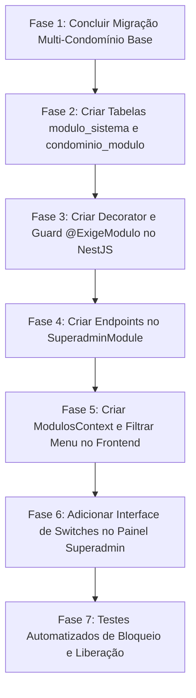

# Plano de Implementação: Arquitetura Modular e Gestão de Módulos por Condomínio

**Data:** 04/11/2026  
**Contexto:** Complemento à arquitetura Multi-Tenancy do OASIS.  
**Objetivo:** Permitir que cada condomínio contratante do OASIS possua um pacote de funcionalidades personalizado. O Superadmin poderá ativar ou desativar módulos específicos (ex.: abertura de chamados, recebimento de encomendas, controle de chaves, mural de avisos, reservas de áreas) para cada condomínio individualmente.

---

## 1. Visão Geral e Justificativa de Negócio

Nem todos os condomínios operam da mesma forma:
- Condomínios pequenos sem portaria física não utilizam o módulo de **Recebimento de Encomendas** nem de **Controle de Chaves**.
- Alguns condomínios contratam apenas o pacote de **Comunicação & Mural**, enquanto outros utilizam a suíte completa com **Reservas de Áreas Comuns** e **Abertura de Chamados**.
- Condomínios sem áreas de lazer reserváveis não necessitam da funcionalidade de agendamento.

Com essa funcionalidade modular:
1. **Redução de Ruído Visual:** O morador, síndico e porteiro visualizam no menu apenas as ferramentas contratadas e ativas no seu condomínio.
2. **Modelo Comercial Flexível (Planos & Preços):** O OASIS pode oferecer planos básico, intermediário e premium.
3. **Controle Centralizado para o Superadmin:** Com 1 clique em *switches* visuais (On/Off), o Superadmin habilita ou revoga recursos para qualquer prédio.

---

## 2. Catálogo Oficial de Módulos do Sistema

| Código do Módulo | Nome Amigável | Descrição | Telas e Recursos Vinculados |
| :--- | :--- | :--- | :--- |
| `RESERVAS_AREAS` | Reservas de Áreas Comuns | Agendamento de salões de festas, churrasqueiras, quadras e cobrança de taxas em boleto | `/morador/reservar`, `/morador/reservas`, `/sindico/areas` |
| `AREAS_LIVRES` | Áreas de Uso Livre | Monitoramento de lotação e ocupação em tempo real (Academia, Piscina) | `/portaria/areas-livres` |
| `ENCOMENDAS_PACOTES` | Gestão de Encomendas | Registro na portaria com código de retirada e notificação ao morador | `/portaria/encomendas`, `/morador/encomendas` |
| `CONTROLE_CHAVES` | Controle de Chaves | Empréstimo, devolução e controle de chaves físicas de áreas técnicas e comuns | `/portaria/chaves` |
| `MURAL_AVISOS` | Mural de Comunicação | Publicação de comunicados gerais com anexos (PDF/fotos) e confirmação de leitura | `/mural`, `/sindico/avisos` |
| `CHAMADOS_OCORRENCIAS` | Gestão de Chamados | Abertura de solicitações particulares (limpeza, avarias) e triagem pelo síndico | `/morador/chamados`, `/sindico/chamados` |
| `DEPENDENTES_FAMILIA` | Gestão de Dependentes | Cadastro e aprovação de vínculos familiares e inquilinos pelos titulares | `/morador/familia`, `/sindico/pessoas` |

---

## 3. Modelagem de Dados (PostgreSQL)

### A. Tabela `modulo_sistema`
Catálogo estático de todos os módulos que a plataforma OASIS disponibiliza.
```sql
CREATE TABLE IF NOT EXISTS modulo_sistema (
    codigo          VARCHAR(40)     PRIMARY KEY,
    nome            VARCHAR(80)     NOT NULL,
    descricao       VARCHAR(255)    NOT NULL,
    categoria       VARCHAR(40)     NOT NULL DEFAULT 'OPERACIONAL',
    icone           VARCHAR(30)     NOT NULL DEFAULT 'wrench',
    ordem_exibicao  INTEGER         NOT NULL DEFAULT 0,
    criado_em       TIMESTAMP WITH TIME ZONE NOT NULL DEFAULT CURRENT_TIMESTAMP
);
```

### B. Tabela `condominio_modulo` (Configuração por Condomínio)
Armazena quais módulos estão ativos para cada condomínio específico.
```sql
CREATE TABLE IF NOT EXISTS condominio_modulo (
    id_condominio_modulo SERIAL PRIMARY KEY,
    id_condominio        INTEGER NOT NULL REFERENCES condominio(id_condominio) ON DELETE CASCADE,
    codigo_modulo        VARCHAR(40) NOT NULL REFERENCES modulo_sistema(codigo) ON DELETE RESTRICT,
    ativo                BOOLEAN NOT NULL DEFAULT TRUE,
    data_ativacao        TIMESTAMP WITH TIME ZONE NOT NULL DEFAULT CURRENT_TIMESTAMP,
    data_desativacao     TIMESTAMP WITH TIME ZONE,
    CONSTRAINT uk_condominio_modulo UNIQUE (id_condominio, codigo_modulo)
);

CREATE INDEX IF NOT EXISTS idx_cm_condo ON condominio_modulo(id_condominio);
CREATE INDEX IF NOT EXISTS idx_cm_ativo ON condominio_modulo(id_condominio, ativo);
```

### C. Carga Inicial Idempotente
Garante que o condomínio atual (OASIS, ID 1) tenha **todos os módulos ativos** por padrão (zero impacto nas funcionalidades já em uso):
```sql
-- Inserção do catálogo de módulos
INSERT INTO modulo_sistema (codigo, nome, descricao, icone, ordem_exibicao) VALUES
('RESERVAS_AREAS', 'Reservas de Áreas Comuns', 'Agendamento de salões, churrasqueiras e áreas reserváveis.', 'calendar', 1),
('AREAS_LIVRES', 'Áreas de Uso Livre', 'Controle de ocupação e lotação para academia e piscina.', 'clock', 2),
('ENCOMENDAS_PACOTES', 'Gestão de Encomendas', 'Registro e retirada de encomendas recebidas na portaria.', 'package', 3),
('CONTROLE_CHAVES', 'Controle de Chaves', 'Empréstimo e devolução de chaves de áreas comuns.', 'key', 4),
('MURAL_AVISOS', 'Mural de Avisos & Comunicados', 'Publicação oficial de avisos com confirmação de leitura.', 'megaphone', 5),
('CHAMADOS_OCORRENCIAS', 'Gestão de Chamados & Avarias', 'Abertura de chamados particulares de manutenção e limpeza.', 'wrench', 6),
('DEPENDENTES_FAMILIA', 'Gestão Familiar & Dependentes', 'Cadastro e aprovação de dependentes e inquilinos.', 'users', 7)
ON CONFLICT (codigo) DO NOTHING;

-- Ativação de todos os módulos para o Condomínio 1 (OASIS)
INSERT INTO condominio_modulo (id_condominio, codigo_modulo, ativo)
SELECT 1, codigo, TRUE FROM modulo_sistema
ON CONFLICT (id_condominio, codigo_modulo) DO NOTHING;
```

---

## 4. Arquitetura Backend (NestJS)

### A. Decorator e Guard de Proteção Modular: `@ExigeModulo`
Garante que requisições a endpoints cujo módulo esteja desativado no condomínio do usuário sejam bloqueadas na porta de entrada da API.

```typescript
// backend/src/common/guards/modulo.guard.ts
export const ExigeModulo = (codigoModulo: string) => SetMetadata('modulo_exigido', codigoModulo);

@Injectable()
export class ModuloGuard implements CanActivate {
  constructor(private reflector: Reflector, private db: DbService) {}

  async canActivate(context: ExecutionContext): Promise<boolean> {
    const moduloExigido = this.reflector.getAllAndOverride<string>('modulo_exigido', [
      context.getHandler(),
      context.getClass(),
    ]);

    if (!moduloExigido) return true;

    const req = context.switchToHttp().getRequest();
    const user = req.user;
    if (!user) return false;

    // Superadmin possui passe livre universal
    if ((user.perfis || []).some((p: any) => p.tipo === 'SUPERADMIN')) return true;

    const idCondominio = user.id_condominio;
    const checagem = await this.db.query(
      `SELECT ativo FROM condominio_modulo WHERE id_condominio = $1 AND codigo_modulo = $2`,
      [idCondominio, moduloExigido]
    );

    if (!checagem.length || !checagem[0].ativo) {
      throw new ForbiddenException(
        `O módulo "${moduloExigido}" não está habilitado para o seu condomínio.`
      );
    }

    return true;
  }
}
```

### B. Endpoints da API de Módulos

1. **Público/Autenticado (Consulta de Módulos do Condomínio do Usuário):**
   - `GET /api/condominios/meus-modulos`: Retorna a lista de códigos de módulos ativos para o frontend renderizar o menu condicionalmente.
2. **Superadmin (Gerenciamento de Módulos):**
   - `GET /api/superadmin/condominios/:id/modulos`: Retorna todos os módulos com status `ativo: true/false`.
   - `PATCH /api/superadmin/condominios/:id/modulos`: Ativa ou desativa módulos específicos para aquele condomínio.
   - Dispara evento de sincronização SSE (`TopicoSync: 'MODULOS'`) para que os usuários logados daquele condomínio vejam os menus atualizados instantaneamente.

---

## 5. Arquitetura Frontend (React)

### A. Contexto Global de Módulos (`ModulosContext.tsx`)
Carrega no boot da aplicação quais módulos estão ativos para o condomínio corrente:
```typescript
interface ModulosContextType {
  modulosAtivos: Set<string>;
  temModulo: (codigo: string) => boolean;
  recarregarModulos: () => Promise<void>;
}
```

### B. Menu Lateral Condicional (`Layout.tsx`)
O item de menu só é renderizado se o módulo estiver ativo (ou se o usuário for `SUPERADMIN`):
```tsx
{temModulo('RESERVAS_AREAS') && item('/morador/reservar', 'Nova Reserva', 'calendar')}
{temModulo('ENCOMENDAS_PACOTES') && item('/morador/encomendas', 'Minhas Encomendas', 'package')}
{temModulo('CHAMADOS_OCORRENCIAS') && item('/morador/chamados', 'Abrir Chamado', 'wrench')}
{temModulo('CONTROLE_CHAVES') && item('/portaria/chaves', 'Controle de Chaves', 'key')}
```

### C. Painel de Gerenciamento do Superadmin (`/superadmin/condominios`)
Na edição ou detalhes do condomínio:
- Uma aba dedicada **"Módulos Contratados"**.
- Lista em cartões com ícone, nome, descrição e um botão *Toggle Switch* estilizado (Verde = Ativo, Cinza = Inativo).
- Botão "Salvar Configuração Modular" com feedback imediato.

---

## 6. Roteiro de Execução Passo a Passo



1. **Etapa 1:** Concluir a migração da arquitetura de banco multi-condomínio (`plano_implementacao_multicondominio.md`).
2. **Etapa 2:** Criar script `banco/migracoes/20261106_modulos_condominio.sql` e automigração em `db.service.ts`.
3. **Etapa 3:** Criar `@ExigeModulo` e `ModuloGuard` no backend, aplicando nos controllers de Reservas, Portaria/Encomendas, Chaves, Chamados e Avisos.
4. **Etapa 4:** Criar `ModulosContext` no frontend e envolver os links do `Layout.tsx`.
5. **Etapa 5:** Desenvolver a interface visual de *Toggle Switches* para o Superadmin ativar/desativar módulos por condomínio.
6. **Etapa 6:** Validar que ao desativar "Chamados" para o Condomínio B, os moradores dele não visualizam o menu e recebem bloqueio adequado na API.

