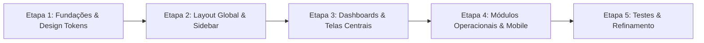

# Plano de Implementação: Redesign UX/UI Sistema OASIS (Baseado no Lettly SaaS)

**Data de Início:** 05/11/2026  
**Branch de Trabalho:** `feat/redesign-ux-ui`  
**Referência Figma:** [Lettly — Rental Property Management SaaS (250+ Screens)](https://www.figma.com/design/RfAkwMyWXnVMIwky7nz4JT/Lettly-%E2%80%94-Rental-Property-Management-SaaS-Desktop---Mobile--250--Screens---Community-?m=auto&t=VrzH31IPjZ42gyud-1) (`RfAkwMyWXnVMIwky7nz4JT`)

---

## 1. Visão Geral e Objetivos

O objetivo deste redesign é elevar a experiência do usuário (UX) e a interface visual (UI) do OASIS ao padrão de produto SaaS internacional de gestão predial/proptech, aproveitando o ecossistema e design tokens do **Lettly**:
- Tipografia unificada e moderna com **Plus Jakarta Sans**.
- Paleta de cores corporativa baseada em Deep Navy (`#0b1830`, `#14264a`, `#2548a0`), superfícies de ardósia suaves (`#f6f7f9`) e contrastes acessíveis.
- Status Pills padronizadas (Verde floresta `#1e8e5a`, Âmbar `#b26a00`, Coral `#c2383d` e Neutro `#525d6e`).
- Sidebar moderna com seletor de condomínio tipo *Workspace Switcher*, navegação agrupada e perfil do usuário ancorado.
- Cartões métricos (KPIs) com ícones contidos e números proeminentes.
- Tabelas densas porém limpas, com paginação integrada e ações diretas.
- **Manutenção rigorosa de 100% da lógica de negócio, APIs, SSE e permissões já existentes.**

---

## 2. Fases do Projeto

---

### Etapa 1 — Fundações e Design Tokens (Em Execução)
* [x] Conexão oficial com a API do Figma e extração dos tokens de design.
* [ ] Atualizar `tailwind.config.js`:
  * Definir **Plus Jakarta Sans** como fonte primária (`sans`, `title`, `display`).
  * Integrar a paleta oficial do Lettly (`lettly-navy`, `lettly-blue`, `lettly-surface`, `lettly-border`, `lettly-text`, `lettly-status`).
  * Atualizar sombras suaves (`shadow-card`, `shadow-soft`, `shadow-modal`) e raios de borda (`rounded-2xl`, `rounded-xl`).
* [ ] Atualizar a biblioteca de componentes base (`frontend/src/components/ui.tsx`):
  * **`Botao`**: Variações primária (Deep Navy com hover suave), secundária (borda limpa e fundo branco), clara e perigo.
  * **`Cartao`**: Fundo branco `#ffffff` / dark `#0e1525`, borda fina `#e2e6ec` / `#1e293b`, raio `rounded-2xl`.
  * **`Badge` / Status Pill**: Pílula arredondada com ponto colorido e tipografia 12px seminegrito.
  * **`Campo` / Inputs / Selects**: Inputs com borda limpa, foco azul realçado e labels uppercase sutis.
  * **`Modal` & `ModalConfirmacao`**: Cabeçalhos elegantes e botões alinhados.
  * **`Paginacao`**: Botões tipo pílula modernos.

---

### Etapa 2 — Estrutura Global (Layout & Sidebar)
* [ ] Redesenhar [`frontend/src/components/Layout.tsx`](file:///c:/Users/Usuario/.gemini/antigravity-ide/scratch/oasis/frontend/src/components/Layout.tsx):
  * **Sidebar Lateral**:
    * Logo OASIS refinado.
    * **Workspace Switcher** no topo: componente tipo dropdown elegante para alternar entre condomínios (Superadmin) ou exibir o condomínio ativo com badge de identificação.
    * Seções agrupadas com títulos em caixa alta sutil (*Visão Geral*, *Morador*, *Operações*, *Administração*, *Sistema*).
    * Itens de navegação com 40px de altura, ícones nítidos e indicador de página ativa em azul com fundo sutil.
    * Rodapé da sidebar com card de usuário compacto (avatar, nome, cargo, atalho para perfil e botão discreto de logout).
  * **Topbar Superior**:
    * Breadcrumbs ou título da página corrente.
    * Barra de busca rápida global.
    * Botão de alternância de Modo Escuro integrado.
    * Indicador de conectividade SSE em tempo real.

---

### Etapa 3 — Dashboards e Telas Centrais
* [ ] **Painel Geral (Administração / Síndico) & Início (Morador):**
  * Grid de KPIs / Métricas com visual inspirado no *Landlord Dashboard* do Lettly (total de unidades ocupadas, chamados pendentes, avisos ativos, encomendas pendentes).
  * Gráficos limpos de uso de áreas comuns e finanças/reservas.
  * Seção de *Atividades Recentes* com badges e timeline limpa.
* [ ] **Gestão de Chamados & Ocorrências (`/sindico/chamados` e `/chamados`):**
  * Inspirado na seção *2.7 Maintenance* do Lettly.
  * Cartões de resumo de chamados em análise, em andamento e concluídos.
  * Tabela moderna com tags de status do Lettly.
  * Gaveta lateral de atendimento com chat particular estilizado.

---

### Etapa 4 — Módulos Operacionais & Morador
* [ ] **Mural de Avisos (`/sindico/avisos` e `/mural`):**
  * Cards de comunicados expansíveis no padrão Lettly, com anexos em miniatura e barra de progresso de leituras.
* [ ] **Pessoas & Unidades (`/sindico/pessoas-unidades`):**
  * Diretório de moradores e unidades inspirado na seção *2.5 Tenants & Leases* do Lettly.
* [ ] **Áreas Comuns & Reservas (`/reservas` e `/sindico/areas`):**
  * Cards visuais das áreas de lazer com tags de capacidade, taxas e galeria de fotos.
* [ ] **Portaria & Encomendas (`/portaria`):**
  * Painel rápido de recebimento de encomendas, controle de chaves e veículos.

---

### Etapa 5 — Verificação, Testes & Responsividade Mobile
* [ ] Validação da responsividade em telas mobile (`390px`), tablets e desktops (`1728px`).
* [ ] Validação do Modo Escuro (Dark Mode) em todos os novos componentes.
* [ ] Execução da suíte de testes automatizada para garantir zero regressões.
* [ ] Commit e documentação final do Redesign.

