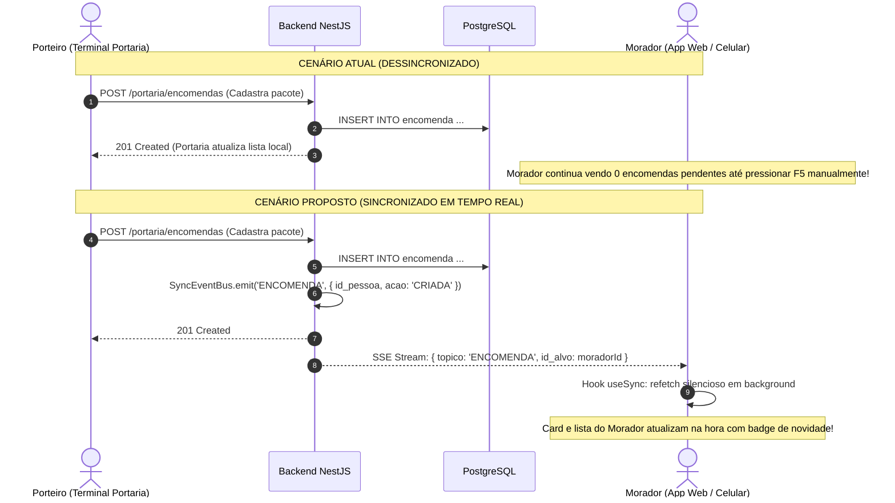
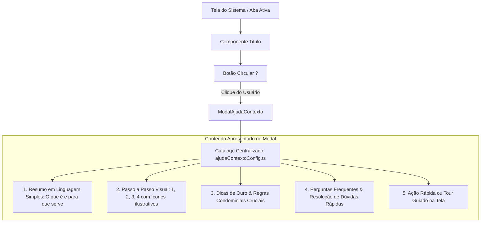
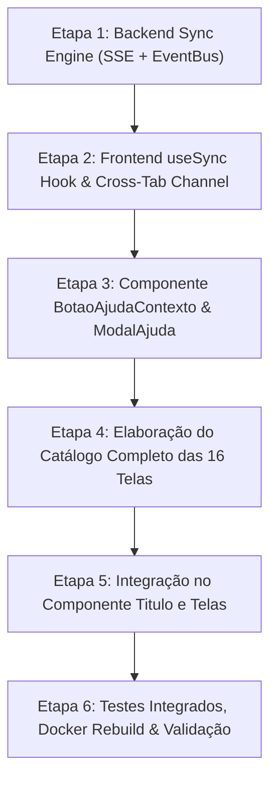

# Plano de Implementação: Sincronicidade de Informações em Tempo Real & Help de Contexto Universal

**Projeto:** OASIS — Sistema de Gestão Condominial Integrada  
**Data:** 03/11/2026  
**Status:** Proposta & Plano de Ação para Aprovação  
**Autores:** Engenharia de Software OASIS & Antigravity AI  

---

## 1. Visão Geral e Justificativa

O sistema **OASIS** atende múltiplos perfis de usuários com rotinas e papéis complementares (Moradores, Porteiros, Síndicos/Administradores e Superadmins). Com o crescimento das operações diárias, foram identificadas duas necessidades fundamentais de evolução:

1. **Sincronicidade de Informações:** As operações que ocorrem na portaria (recebimento de encomendas, empréstimo de chaves, ocupação de áreas livres) ou entre moradores (reservas de áreas, publicação de comunicados pelo síndico) precisam refletir de forma instantânea e consistente em todas as telas abertas, sem depender de recargas manuais de página (F5) ou exibir contadores desatualizados.
2. **Help de Contexto Universal (Suporte ao Usuário Iniciante/Inexperiente):** Moradores recém-chegados, porteiros em treinamento ou usuários com pouca familiaridade com sistemas digitais precisam de orientação intuitiva e direta. Todas as abas do sistema devem conter um botão circular destacado com um ponto de interrogação (`?`), que abra uma explicação passo a passo de como navegar, utilizar as ferramentas e cumprir as regras daquela tela (ex: como agendar um espaço, prazos de devolução de chave, como retirar encomendas).

Este documento detalha o diagnóstico completo do código atual, a arquitetura proposta para a sincronização, a especificação do componente e catálogo de Help de Contexto, o plano de implementação faseado e perguntas para alinhamento com a equipe gestora.

---

## 2. Varredura do Código: Diagnóstico de Sincronicidade

Realizamos uma varredura completa nos módulos do backend (`NestJS`) e no frontend (`React 18 + Vite`).

### 2.1. Pontos Críticos de Defasagem Identificados

| Módulo / Tela | Ação Desencadeadora | Impacto Atual de Dessincronização | Criticidade |
| :--- | :--- | :--- | :---: |
| **Portaria $\leftrightarrow$ Morador (Encomendas)** | Porteiro recebe pacote em `/portaria/encomendas` ou dá baixa na entrega. | O Morador em `/morador/encomendas` ou no painel `/inicio` (card "Encomendas") **não recebe aviso** até recarregar manualmente a página. | **Alta** |
| **Morador $\leftrightarrow$ Portaria (Reservas de Áreas Comuns)** | Morador reserva ou cancela um espaço em `/morador/reservar` ou `/morador/reservas`. | O Porteiro em `/portaria/painel` só vê a ocupação após intervalo rígido de 60s. Outros moradores navegando nos horários da mesma área continuam vendo o slot como livre até forçarem nova consulta. | **Alta** |
| **Portaria $\leftrightarrow$ Morador (Áreas de Uso Livre)** | Porteiro altera o status da academia/piscina para `EM_USO` em `/portaria/areas-livres`. | A tela `/morador/reservar` (aba "Áreas Livres") só carrega no `mount` inicial. O morador vê status desatualizado achando que a área está livre/ocupada. | **Alta** |
| **Portaria $\leftrightarrow$ Morador (Controle de Chaves)** | Porteiro registra empréstimo ou devolução de chave no claviculário em `/portaria/chaves`. | O painel `/inicio` do morador (card "Chaves em Posse") e os alertas de posse superior a 24 horas não atualizam em tempo real. | **Média** |
| **Síndico $\leftrightarrow$ Moradores/Portaria (Mural de Avisos)** | Síndico publica aviso geral ou com anexo em `/sindico/avisos`. | O badge de avisos não lidos no `/inicio` e a lista do `/mural` permanecem defasados até o usuário trocar de página ou dar F5. | **Média** |
| **Síndico $\leftrightarrow$ Morador (Aprovações de Dependentes)** | Morador cadastra dependente; Síndico aprova ou reprova em `/sindico/pessoas`. | A fila de aprovações pendentes do síndico e o status do familiar do morador não atualizam sozinhos. | **Média** |
| **Multi-Aba / Segundo Plano (Background Tab)** | Usuário tem 2 abas abertas ou deixa a aba minimizada por horas. | O sistema não revalida ao voltar o foco (`window.focus` / `visibilitychange`) nem comunica abas entre si (`BroadcastChannel`), mantendo dados obsoletos na tela. | **Alta** |

---

## 3. Arquitetura da Solução: Sincronicidade de Informações

Para garantir que o OASIS seja veloz, confiável e não sobrecarregue o banco de dados nem exija infraestrutura externa pesada (como servidores Redis ou broker separado), a solução adota um modelo híbrido em 3 camadas:

### 3.1. Camada 1: Server-Sent Events (SSE) Leve no Backend

- **Por que SSE em vez de WebSockets puros?**
  - Todas as mutações do OASIS já são requisições HTTP REST padronizadas (`POST`, `PUT`, `PATCH`, `DELETE`) com JWT e validação estrita.
  - A comunicação em tempo real necessária é predominantemente **Servidor $\rightarrow$ Cliente** (avisar que algo mudou).
  - O SSE opera sobre HTTP/1.1 e HTTP/2 padrão, compatível com o proxy Nginx existente no Docker, sem problemas de upgrade de protocolo ou handshakes complexos de WebSocket.
  - O navegador gerencia reconexão automática nativa através da API `EventSource`.

#### Estrutura Técnica no Backend:
1. **`SyncService` (`backend/src/sync/sync.service.ts`):**
   - Mantém um `Subject<SyncEvento>` RxJS.
   - Fornece o método `emitir(topico: TopicoSync, payload: any)`.
   - Controla conexões ativas por usuário autenticado (`sub` do JWT).
2. **`SyncController` (`backend/src/sync/sync.controller.ts`):**
   - Rota `@Sse('sync/stream')` protegida por `JwtAuthGuard`.
   - Devolve um `Observable<MessageEvent>` contendo notificações do condomínio ou direcionadas ao usuário.
3. **Disparadores nos Controllers Existentes:**
   - Ao criar/cancelar reserva $\rightarrow$ emite evento `RESERVAS`.
   - Ao receber/entregar encomenda $\rightarrow$ emite evento `ENCOMENDAS`.
   - Ao alterar status de área livre $\rightarrow$ emite evento `AREAS_LIVRES`.
   - Ao emprestar/devolver chave $\rightarrow$ emite evento `CHAVES`.
   - Ao publicar comunicado $\rightarrow$ emite evento `AVISOS`.
   - Ao cadastrar/aprovar morador $\rightarrow$ emite evento `PESSOAS`.

### 3.2. Camada 2: Hook Frontend `useSync` & EventBus Reativo

- Um hook central `useSync(topicos: TopicoSync[], onSync: () => void)`:
  - Inscreve a tela ativa para ouvir eventos dos tópicos que ela consome (ex: a tela `MinhasReservas` escuta `['RESERVAS']`).
  - Ao receber o sinal, chama a função de recarregamento suave sem piscar a tela.
- **Canal Local `BroadcastChannel('oasis-channel')`:**
  - Se o usuário estiver com duas abas abertas no mesmo navegador, as ações executadas em uma aba (ex: marcar aviso como lido) propagam instantaneamente para as outras abas sem nem esperar a resposta do servidor.

### 3.3. Camada 3: Revalidação no Foco e Polling Adaptativo de Fallback

- **Revalidação no Foco (`window.focus` & `visibilitychange`):**
  - Se o usuário alternar para outra janela ou bloquear o celular e retornar após alguns minutos, a tela ativa checa se os dados têm mais de 15 segundos e revalida automaticamente.
- **Polling Adaptativo de Fallback:**
  - Caso o navegador esteja em uma rede corporativa que bloqueie streams SSE, o frontend detecta e ativa o fallback de polling leve (portaria a cada 10s-15s, moradores a cada 30s-45s, pausando 100% se a aba estiver minimizada para poupar dados e bateria).

---

## 4. Arquitetura da Solução: Help de Contexto Universal

### 4.1. Componente Visual: `BotaoAjudaContexto`

- **Aparência:** Um botão circular elegante com ponto de interrogação centralizado (`?`).
  - Cores: Azul clássico suave `bg-navy-50 text-navy hover:bg-navy-100 ring-1 ring-navy/15 dark:bg-slate-800 dark:text-sky-400 dark:hover:bg-slate-700`.
  - Dimensões: `w-8 h-8` ou `w-9 h-9` com transição e sombra sutil.
  - Efeito para novatos: No primeiro acesso à tela, emite um pulso sutil ou um ponto indicador convidando ao clique.
  - Tooltip: *"Ajuda: Como usar esta tela?"*.

### 4.2. Ponto de Integração Universal: Componente `<Titulo>`

A varredura confirmou que **todas as 16 telas** do sistema utilizam o componente padronizado `<Titulo>`.
Ao atualizar o componente `<Titulo>` para aceitar a propriedade `ajudaKey` (ou detectar a rota atual automaticamente), garantimos:
1. **100% de consistência visual:** O botão `?` fica localizado exatamente no cabeçalho da página, ao lado do título ou no bloco de ações superiores.
2. **Suporte a sub-abas:** Telas com seletor interno de abas (ex: `NovaReserva` com abas "Com Reserva" e "Uso Livre"; `Pessoas` com "Cadastros", "Aprovações" e "Estrutura") podem passar a chave específica da sub-aba ativa, adaptando a orientação na hora.

---

## 5. Catálogo Detalhado de Ajuda por Aba e Perfil

O catálogo centralizado (`ajudaContextoConfig.ts`) conterá as instruções completas para todas as rotas do OASIS:

### 5.1. Módulo Morador
1. **Nova Reserva (`/morador/reservar`):**
   - **Objetivo:** Agendar áreas de lazer com comodidade ou consultar espaços livres.
   - **Passo a Passo:** 
     1. Escolha a área desejada (Salão de Festas, Churrasqueira, etc.).
     2. Selecione a data no calendário (dias com pontos coloridos têm horários já ocupados).
     3. Escolha o turno ou slot de horário disponível.
     4. Informe o número aproximado de pessoas e revise as regras de uso.
     5. Clique em "Confirmar Reserva".
   - **Regras:** Cancelamento com até $X$ horas de antecedência; taxa de limpeza debitada na cota condominial (se houver); limite de reservas ativas por semana.
2. **Minhas Reservas (`/morador/reservas`):**
   - **Objetivo:** Acompanhar status, histórico e cancelamento de reservas.
   - **Passo a Passo:** Visualizar agendamentos futuros, baixar comprovante/detalhes e botão de cancelamento respeitando a antecedência mínima permitida.
3. **Minhas Encomendas (`/morador/encomendas`):**
   - **Objetivo:** Consultar pacotes e entregas recebidas na portaria.
   - **Passo a Passo:** Como verificar código de rastreio/descrição, quem recebeu na portaria e orientações para retirada com documento ou autorização de terceiros.
4. **Minha Família (`/morador/familia`):**
   - **Objetivo:** Cadastrar cônjuge, filhos e parentes residentes.
   - **Passo a Passo:** Como adicionar novo dependente, documentos exigidos, status de moderação pelo síndico ("Aguardando Aprovação") e ativação de login independente.
5. **Mural de Avisos (`/mural`):**
   - **Objetivo:** Ficar por dentro dos comunicados oficiais da administração.
   - **Passo a Passo:** Filtrar avisos por "Não Lidos", abrir comunicado para marcar automaticamente como lido, visualizar anexos (PDFs de assembleias, circulares e imagens).

### 5.2. Módulo Portaria
6. **Painel da Portaria (`/portaria/painel`):**
   - **Objetivo:** Controle operacional imediato do condomínio.
   - **Passo a Passo:** Como identificar áreas ocupadas agora, reservas com atraso no encerramento (alerta vermelho), agenda completa do dia e atalho para cadastro de visitantes.
7. **Áreas de Uso Livre (`/portaria/areas-livres`):**
   - **Objetivo:** Gestão de espaços sem agendamento (Academia, Piscina, Sala de Jogos).
   - **Passo a Passo:** Como alternar o botão entre `LIVRE` e `EM USO`, registrar observações ao vivo da ronda (ex: "Em manutenção para limpeza de filtros").
8. **Encomendas da Portaria (`/portaria/encomendas`):**
   - **Objetivo:** Recepção, registro e entrega segura de mercadorias.
   - **Passo a Passo:** Como buscar a unidade por apartamento, selecionar o morador destinatário, registrar tipo/tamanho do pacote e dar baixa informando quem retirou (próprio morador ou terceiro).
9. **Controle de Chaves (`/portaria/chaves`):**
   - **Objetivo:** Claviculário eletrônico e custódia de chaves de serviço e áreas comuns.
   - **Passo a Passo:** Localizar a chave no claviculário, registrar empréstimo vinculando morador ou prestador de serviço credenciado, devolução e acompanhamento do alerta de posse superior a 24 horas.

### 5.3. Módulo Administração (Síndico)
10. **Painel Geral (`/sindico/painel`):**
    - **Objetivo:** Métricas gerenciais, indicadores de ocupação e visão consolidada.
    - **Passo a Passo:** Como analisar taxa de uso dos espaços, volume mensal de encomendas e ocorrências registradas.
11. **Áreas Comuns (`/sindico/areas`):**
    - **Objetivo:** Parametrizar espaços, horários de funcionamento e regras.
    - **Passo a Passo:** Criar nova área, definir se requer reserva prévia ou é livre, configurar janelas de horários por dia da semana, regras de cancelamento, antecedência e bloqueios temporários de manutenção.
12. **Pessoas & Unidades (`/sindico/pessoas`):**
    - **Objetivo:** Gestão de cadastros de moradores, moderação e estrutura física.
    - **Passo a Passo:** Aba 1 (Pessoas e unidades, edição, inativação segura e penalidades); Aba 2 (Aprovação ou rejeição de cadastros de dependentes com justificativa); Aba 3 (Gestão estrutural em modo consulta).
13. **Publicar Avisos (`/sindico/avisos`):**
    - **Objetivo:** Emissão de comunicados e convocações oficiais.
    - **Passo a Passo:** Escrever título e mensagem, selecionar público-alvo (todos, apenas moradores, apenas porteiros), fixar comunicado no topo do mural e anexar documentos (PDF/imagens).

### 5.4. Módulo Superadmin
14. **Estrutura Física & Vagas (`/superadmin/estrutura`):**
    - **Objetivo:** Engenharia física do condomínio.
    - **Passo a Passo:** Como usar o Gerador em Lote para criar blocos e andares inteiros, vincular vagas de garagem com metragem quadrada (m²) calculada e gerenciar a numeração de unidades.
15. **Pessoas & Administradoras (`/superadmin/pessoas`):**
    - **Objetivo:** Governança mestra e contas de alto nível.
    - **Passo a Passo:** Criar e gerenciar síndicos, vincular administradoras terceirizadas e gerenciar permissões de acesso ao sistema.

### 5.5. Painel Inicial Unificado
16. **Início (`/inicio`):**
    - **Objetivo:** Visão consolidada para o dia a dia.
    - **Passo a Passo:** O que significa cada cartão de resumo (minhas reservas, encomendas aguardando, avisos não lidos, chaves em posse), atalhos rápidos e saudação contextual.

---

## 6. Sugestões de Melhorias & Recursos Adicionais

Como parte do planejamento, sugerimos as seguintes melhorias para elevar a usabilidade e robustez do OASIS:

> [!TIP]
> **1. Modo "Tour Guiado" Interativo (Walkthrough na Tela):**
> Além de ler o passo a passo dentro do modal, o usuário pode clicar em um botão **"Fazer Tour Guiado nesta Tela"**. Uma caixinha com balão flutuante aponta diretamente para os botões reais da página (ex: *"1. Clique aqui para escolher a data"*, *"2. Veja aqui os horários"*), tornando a experiência de aprendizado 100% prática.

> [!TIP]
> **2. Toast de Sincronização Sutil:**
> Quando uma encomenda chegar na portaria para o morador, ou quando o síndico publicar um novo aviso, além de atualizar os números na tela, o sistema exibe uma pequena notificação no canto superior direito:  
> *"📦 Uma nova encomenda acabou de ser registrada para o seu apartamento."*  
> O morador pode clicar na notificação e ir direto para a tela de encomendas.

> [!TIP]
> **3. Indicador de Conexão em Tempo Real:**
> No rodapé ou no cabeçalho ao lado do perfil, adicionar um ponto verde discreto:  
> `● Conectado em tempo real (Sincronizado)`  
> Se a internet do usuário oscilar, o indicador mostra `○ Reconectando...`, transmitindo total segurança de que os dados exibidos são confiáveis e atuais.

> [!TIP]
> **4. Reconhecimento de Primeiro Acesso (Onboarding automático):**
> Salvar no `localStorage` as telas que o usuário já visitou. Na primeira vez que ele entrar em uma tela nova (ex: primeira vez que um novo morador entra em "Nova Reserva"), o botão `?` exibe uma dica convidativa: *"Novo por aqui? Clique para ver como reservar em 4 passos rápidos!"*.

---

## 7. Perguntas para Alinhamento com o Usuário

Para customizarmos os detalhes de implementação exatamente conforme a sua preferência operacional, gostaríamos do seu direcionamento nos seguintes pontos:

1. **Notificações Flutuantes (Toasts em tempo real):**  
   Quando o sistema sincronizar novos dados em background (ex: uma encomenda recebida ou novo comunicado publicado), você prefere que apareça uma pequena notificação flutuante no canto da tela (toast) avisando o morador, ou apenas que os contadores e listas atualizem silenciosamente?
2. **Posição do Botão `?` (Help de Contexto):**  
   Nossa recomendação é posicionar a bolinha com `?` no cabeçalho de cada página (ao lado do título `<Titulo>`), ficando visualmente limpa e integrada. Você gostaria que existisse também um botão de ajuda fixo/flutuante no rodapé ou no menu lateral?
3. **Inclusão do Tour Guiado Interativo:**  
   Você aprova incluirmos a opção de **Tour Guiado** (balões flutuantes que apontam diretamente para os botões da tela enquanto o usuário navega), além do modal explicativo de passo a passo?
4. **Intervalo de Sincronização:**  
   Com a solução SSE + Smart Polling, os eventos chegam em menos de 1 segundo. Para as telas operacionais da portaria (onde a movimentação é intensa), você aprova esse padrão instantâneo?

---

## 8. Cronograma e Etapas de Execução

| Etapa | Atividades Previstas | Arquivos Impactados |
| :--- | :--- | :--- |
| **Etapa 1** | Implementação do `SyncModule`, `SyncService` e `@Sse('sync/stream')` no NestJS. Disparo de eventos nas rotas de encomendas, reservas, chaves, áreas livres e avisos. | `backend/src/sync/*`, `backend/src/app.module.ts`, `backend/src/portaria/*`, `backend/src/reservas/*` |
| **Etapa 2** | Criação do hook `useSync`, cliente SSE com reconexão automática, revalidação ao focar na janela (`window.focus`) e `BroadcastChannel('oasis-sync')`. | `frontend/src/hooks/useSync.ts`, `frontend/src/api.ts` |
| **Etapa 3** | Criação dos componentes `BotaoAjudaContexto` e `ModalAjudaContexto` com acessibilidade, responsividade e tema claro/escuro. | `frontend/src/components/AjudaContexto.tsx`, `frontend/src/components/ui.tsx` |
| **Etapa 4** | Estruturação e redação detalhada do catálogo de ajuda para todas as 16 abas e sub-abas do sistema. | `frontend/src/config/ajudaContextoConfig.ts` |
| **Etapa 5** | Integração do botão `?` no componente `<Titulo>` e vinculação contextual em todas as páginas do Morador, Portaria, Síndico e Superadmin. | `frontend/src/components/ui.tsx`, `frontend/src/pages/**/*` |
| **Etapa 6** | Build completo do frontend (`npm run build`), reconstrução dos containers Docker e testes ponta a ponta com múltiplos perfis abertos simultaneamente. | Ambiente Docker `oasis-frontend`, `oasis-backend` |

---

## 9. Conclusão

Com este plano aprovado, o **OASIS** dará um salto de maturidade e usabilidade:
- **Informações 100% Sincronizadas:** Chega de dados defasados, desencontros entre portaria e moradores ou necessidade de apertar F5 para checar se uma encomenda chegou ou se uma área foi liberada.
- **Ajuda Intuitiva e Onboarding Sem Fricção:** Qualquer usuário novato, por mais inexperiente que seja, terá sempre à mão uma bolinha com `?` com instruções claras, práticas e didáticas para navegar com autonomia e segurança em qualquer tela do condomínio.

